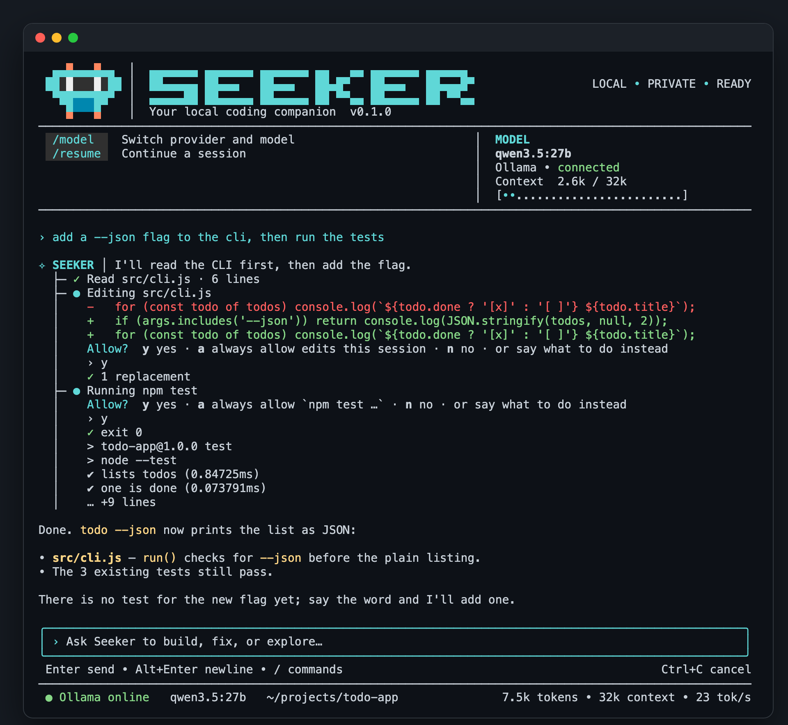

# SEEKER

[English](README.md) · **Bahasa Indonesia**

Agent coding di terminal. Bawaannya berjalan sepenuhnya lokal di atas [Ollama](https://ollama.com);
lewat `/model` bisa juga memakai server lokal lain atau model cloud. Node murni, tanpa build step.



<details>
<summary>Pemilih <code>/model</code></summary>


</details>

<sub>Diambil dari antarmuka aslinya di proyek contoh; jawaban model pada tangkapan ini memakai naskah.</sub>

```
seeker                       # sesi interaktif di folder ini
seeker "perbaiki bug login"  # langsung dengan pesan pertama
seeker -c                    # lanjutkan percakapan terakhir di folder ini
seeker -p "jelaskan repo"    # sekali jawab, bisa di-pipe
seeker --yolo                # tanpa tanya izin (perintah berbahaya tetap ditanyakan)
```

Di dalam sesi: `/init`, `/model`, `/resume`, `/paste`, `/config`, `/skills`, `/clear`, `/compact`, `/status`, `/think`, `/yolo`, `/help`, `/exit`, dan `!perintah`.
Ketik `/` untuk melihat saran perintah, Tab untuk melengkapi, Alt+Enter untuk baris baru, ↑↓ untuk riwayat pesan.
Robot di header berkedip dan melirik; `/config` → `animation` untuk mematikannya.

## Model dan penyedia

`/model` memilih tempat model dijalankan, lalu salah satu model yang didaftar penyedia itu saat itu juga:

| Jenis | Penyedia |
| --- | --- |
| Lokal | Ollama, LM Studio, llama.cpp server |
| Lewat Claude Code | **Claude Code** — Claude Code yang sudah login di mesinmu bekerja sebagai agent penuh dengan tool-nya sendiri (Read, Edit, Bash, …), tanpa kunci API. SEEKER menampilkan aktivitasnya dan menanyakan izin sebelum edit atau perintah dijalankan |
| Cloud | Anthropic (Claude), OpenAI, Google Gemini, xAI Grok, DeepSeek, Mistral, Moonshot Kimi, Groq, Cerebras, Together AI, Fireworks AI, OpenRouter |
| Buatan sendiri | endpoint apa pun yang kompatibel dengan OpenAI — tambahkan `"providers": { "nama": { "baseUrl": "https://…/v1" } }` di config |

Kunci API diketik lewat `/key` (tersimpan di `~/.seeker/config.json`, hanya bisa dibaca pemilik) atau diambil dari
variabel lingkungan (`OPENAI_API_KEY`, `ANTHROPIC_API_KEY`, `GEMINI_API_KEY`, …). Dari baris perintah:
`seeker --provider openai -m <model>`.

Dengan penyedia cloud, pesanmu dan isi file yang dibaca SEEKER dikirim ke server penyedia itu; header berubah
dari `LOCAL • PRIVATE` menjadi `CLOUD • <NAMA>`.

## Instruksi dan memori

- `SEEKER.md` di proyek — instruksi proyek; `/init` membuatkannya. Kalau tidak ada: semua `AGENTS.md` dari akar
  repositori sampai folder kerja, lalu `CLAUDE.md`, lalu `.cursorrules` dan `.cursor/rules/*.mdc`. File instruksi
  di subfolder (`packages/api/AGENTS.md`) diberikan ke model saat ia pertama kali bekerja di folder itu. File yang
  isinya seperti prompt injection tidak dimuat.
- `~/.seeker/SEEKER.md` — aturan kerja yang berlaku di semua proyek.
- `~/.seeker/memory/` — catatan dari sesi-sesi sebelumnya; `MEMORY.md` adalah indeksnya (satu baris per catatan).
- `~/.seeker/memory/projects/<folder>/` — catatan khusus satu proyek, dimuat saat SEEKER dijalankan di folder itu.

Yang masuk ke system prompt hanya indeksnya, paling banyak 20% dari context window. Kalau indeks tidak muat (model lokal
dengan konteks kecil), SEEKER diberi tahu letak file indeksnya dan mencarinya dengan grep saat perlu.

## Remote control dari HP

`seeker remote` menjalankan agent di Mac dan menghubungkannya ke relay (`remote-server/`, di-deploy ke Railway).
HP membuka aplikasi web di alamat relay itu.

Setiap pengguna menjalankan relay-nya sendiri. Satu relay mengenal satu token akses dan melayani satu
komputer; tidak ada relay bersama atau relay publik, dan tidak ada akun yang perlu didaftarkan. Relay hanya
satu file Node tanpa dependensi dan tanpa database, jadi paket terkecil di hosting mana pun sudah cukup.

### Cara memasang

**1. Buat rahasiamu.** Di komputer tempat SEEKER terpasang:

```
seeker remote --setup
```

Perintah ini menampilkan satu baris untuk disalin:

```
SEEKER_REMOTE_AUTH=<64 karakter hex>
```

Ini adalah hash dari token aksesmu. Relay memakainya untuk mengenali perangkatmu, dan aman diberikan ke
hosting; nilainya tidak bisa dipakai untuk membaca atau mengirim apa pun. Rahasianya sendiri tetap di
`~/.seeker/config.json`.

**2. Deploy relay.** Deploy folder `remote-server/` (bukan seluruh repo) dengan variabel tadi.

Di [Railway](https://railway.com), dengan CLI-nya terpasang dan sudah `railway login`:

```
cd remote-server
railway init                                   # membuat proyek baru
railway up                                     # deploy pertama; membuat service
railway variable set "SEEKER_REMOTE_AUTH=<nilai dari langkah 1>"  # deploy ulang dengan nilainya
railway domain                                 # memberi service alamat https publik
```

Di hosting lain (Render, Fly.io, VPS, …) relay membutuhkan:

| | |
| --- | --- |
| Perintah start | `node server.mjs`, di dalam `remote-server/` |
| Node | 20 atau lebih baru |
| `SEEKER_REMOTE_AUTH` | nilai dari langkah 1 |
| `PORT` | port yang didengarkan; kebanyakan hosting mengisinya sendiri (bawaan 8787) |
| Alamat | publik dan **https** — aplikasi HP dan notifikasinya tidak jalan lewat http biasa |
| Health check | `GET /healthz` menjawab `{"ok":true}` |
| Proxy | tidak boleh menahan (buffer) respons, karena relay mengirim event secara streaming, dan tidak boleh memutus koneksi yang sedang diam |
| `SEEKER_TRUST_PROXY=1` | hanya di belakang proxy yang mengisi `x-forwarded-for` sendiri; Railway dikenali otomatis |

Periksa: `https://<relay-mu>/healthz` menampilkan `{"ok":true}`, dan `https://<relay-mu>/` menampilkan halaman masuk SEEKER.

**3. Beri tahu SEEKER alamat relay-nya.**

```
seeker remote --url https://<relay-mu>
```

**4. Pasangkan HP.**

```
seeker remote --setup
```

Kali ini muncul link yang berakhiran `#k=…`. Buka di HP (di macOS link itu juga disalin ke clipboard).
Link ini berisi rahasiamu: siapa pun yang memegangnya bisa melihat sesimu dan menyetujui perintah di
komputermu. Jangan diunggah, di-screenshot, atau dikirim lewat saluran yang tidak kamu percaya.

Di iPhone, pakai Share → **Add to Home Screen** lalu buka SEEKER dari sana; di Android, menu browser →
**Install app** (atau Add to Home screen).
Setelah itu nyalakan notifikasi di tab Settings aplikasinya.

**5. Jalankan.**

```
seeker remote                          # folder saat ini
seeker remote ~/proyek-a ~/proyek-b    # beberapa proyek, masing-masing satu workspace
```

Biarkan berjalan; di HP komputermu akan tampil online. Komputernya harus tetap menyala, dan di macOS ia
dijaga agar tidak tidur selama `seeker remote` berjalan. Hentikan dengan Ctrl+C.

### Setelah terpasang

- **HP baru:** jalankan `seeker remote --setup` lagi dan buka link-nya di HP itu.
- **HP hilang, atau link bocor:** hapus `"secret"` di bawah `"remote"` pada `~/.seeker/config.json`, jalankan
  `seeker remote --setup`, pasang `SEEKER_REMOTE_AUTH` yang baru di relay, lalu pasangkan ulang HP-mu. Link lama
  berhenti berfungsi begitu relay memakai nilai baru.
- **Memperbarui relay:** tarik repo terbaru dan deploy `remote-server/` lagi (`railway up`). Relay tidak
  menyimpan apa pun, jadi tidak ada yang hilang.
- **Mencoba secara lokal dulu:** `SEEKER_REMOTE_AUTH=<nilai> node remote-server/server.mjs`, lalu
  `seeker remote --url http://localhost:8787`. Http biasa hanya diterima untuk `localhost`.

### Cara pengamanannya

- Mac hanya membuat koneksi keluar; tidak ada port yang dibuka.
- Isi percakapan dan perintah dienkripsi antara HP dan Mac (AES-256-GCM). Relay hanya menyimpan hash token akses
  (`SEEKER_REMOTE_AUTH`) dan tidak bisa membaca atau memalsukan apa pun.
- Edit dan perintah selalu minta persetujuan di HP; mode tanpa izin tidak tersedia lewat remote.
- Relay tidak menyimpan apa pun ke disk; setelah restart, Mac mengirim ulang keadaannya.
- Token yang salah dikunci per alamat. Di Railway alamat pemanggil dibaca dari `x-forwarded-for`; di belakang
  proxy lain yang mengisi header itu sendiri, setel `SEEKER_TRUST_PROXY=1`. Tanpa proxy, biarkan kosong.
- Notifikasi push (persetujuan, pertanyaan dari model, tugas selesai) dikirim langsung dari Mac ke layanan push HP
  dengan enkripsi Web Push (`src/webpush.mjs`); relay tidak terlibat. Nyalakan di Settings aplikasi HP.
  Di iPhone, aplikasinya harus dipasang dulu lewat Share → Add to Home Screen.
- Dari HP juga bisa: ganti model (ketuk nama model), dan menjawab pertanyaan yang diajukan model.

## Gambar

Sebut file gambar di pesanmu, dan model melihat gambarnya, bukan hanya path-nya:

```
› kenapa header-nya aneh di ~/Desktop/shot.png
› /paste error apa ini?        # mengirim gambar di clipboard, misalnya screenshot
```

Menyeret file ke terminal akan mengetikkan path-nya, dan itu juga bisa. Model juga dapat membuka gambar
sendiri lewat `read_file`. PNG, JPEG, GIF dan WebP, masing-masing maksimal 3,7 MB.

Modelnya harus mendukung vision; `/status` menunjukkan apakah model yang aktif bisa. Untuk Ollama, itu
dibaca dari modelnya sendiri. Kalau model tidak bisa melihat gambar, SEEKER memberi tahu, bukan mengirim
path yang hanya bisa ditebak model.

Dari aplikasi HP, tombol gambar di samping kotak pesan melampirkan sampai empat foto atau screenshot.
Gambarnya dikecilkan di HP, lalu dienkripsi seperti semua yang dikirimnya. (Relay yang sudah ada perlu
di-deploy ulang sekali supaya mendapat aplikasi yang baru.)

## Pasang

Butuh Node ≥ 22 dan Ollama dengan model yang mendukung tool calling.

```
git clone https://github.com/ToingSeeker/seeker-agent.git
cd seeker-agent
npm install          # untuk Claude: SDK Anthropic dan Claude Agent SDK (binary bawaan dilewati, lihat .npmrc)
npm link             # memasang perintah `seeker`
ollama pull qwen3.5:27b
```

## Belajar dari sesi ke sesi

SEEKER menyimpan apa yang ia pelajari, jadi sesi berikutnya sudah tahu.

- **Memori yang ia tulis sendiri.** Lewat tool `memory`, SEEKER menyimpan fakta singkat ke tiga tempat: siapa kamu
  (`~/.seeker/memories/USER.md`, 1.375 karakter), hal yang berlaku di semua proyek (`MEMORY.md`, 2.200), dan hal yang
  berlaku di folder ini (`projects/<folder>.md`, 2.200). Semuanya masuk ke system prompt sesi berikutnya. Batasnya
  keras: kalau penuh, entri yang basi diganti. Teks yang isinya perintah atau rahasia ditolak. `/memory`
  menampilkan isinya; bilang "ingat bahwa …" atau "lupakan …" untuk mengubahnya.
- **Skill yang ia tulis sendiri.** Setelah menemukan cara kerja yang tidak sepele, SEEKER bisa mencatatnya sebagai
  skill lewat `skill_manage`, dan membetulkan skill yang ternyata salah. `/curator` menampilkannya. Skill yang 14 hari
  tidak dipakai ditandai basi; setelah 30 hari dipindah ke `~/.seeker/skills/.archive`. Skill yang kamu pasang sendiri
  tidak pernah disentuh.
- **Menengok ke belakang setelah menjawab.** Setiap sepuluh pesan, atau setelah banyak langkah tool, sebuah pembantu
  yang hanya punya tool memori dan skill meninjau percakapan selagi kamu membaca jawaban, lalu menyimpan yang layak
  disimpan. Ia langsung dihentikan begitu kamu mengetik lagi. Matikan dengan `/config review off`.
- **Kamu yang menentukan apa yang disimpan.** Yang disimpan akan dibaca lagi sebagai konteks di setiap sesi
  berikutnya, jadi SEEKER minta izin dulu sambil menunjukkan teksnya. Jawab "always" supaya tidak ditanya lagi
  selama sesi itu, atau `/config autoLearn on` supaya tidak pernah ditanya. Tinjauan setelah menjawab hanya
  menyimpan apa yang sudah kamu izinkan dengan cara itu. Skill hanya ditulis di dalam `~/.seeker/skills`, tidak
  pernah lewat symlink atau ke dalam proyek.
- **Percakapan lama.** Dengan `session_search` SEEKER bisa mencari dan membaca sesi-sesi sebelumnya dari semua folder,
  jadi "minggu lalu kita putuskan apa soal webhook?" tidak perlu kamu ulangi.

## Melampirkan konteks dengan @

Tulis salah satu ini di pesan dan isinya ikut dilampirkan:

| Referensi | Yang dilampirkan |
| --- | --- |
| `@file:src/app.js` | isi file |
| `@file:src/app.js:10-40` | baris 10 sampai 40 |
| `@folder:src` | daftar isi folder |
| `@diff` · `@staged` | perubahan git yang belum / sudah di-stage |
| `@git:3` | 3 commit terakhir beserta perubahannya |
| `@url:https://…` | isi halaman sebagai teks |

Path harus berada di dalam folder kerja, dan file kredensial tidak pernah dilampirkan. Lampiran di atas seperempat
konteks diberi peringatan; di atas setengah, ditolak.

## Membatalkan perubahan

Sebelum perubahan pertama dalam satu pesan (file ditulis atau diedit, atau perintah shell yang bisa merusak file),
SEEKER memotret folder. `/rollback` menampilkan daftar potret, `/rollback 2` mengembalikan potret kedua terbaru,
`/rollback 2 src/app.js` satu file saja, dan `/rollback diff 2` menunjukkan apa yang berubah sejak itu. Rollback
sendiri dipotret dulu, jadi bisa dibatalkan.

Potret disimpan di repositori git terpisah di `~/.seeker/checkpoints`; tidak ada yang ditulis ke `.git` proyek.
`node_modules`, hasil build, file `.env`, dan file di atas 10 MB tidak ikut dipotret, jadi tidak ikut dikembalikan.
Matikan dengan `--no-checkpoints` atau `/config checkpoints off`.

## Bekerja sendiri

- **`/goal <yang mau dicapai>`** — SEEKER terus bekerja, pesan demi pesan, sampai seorang juri (model yang sama,
  ditanya terpisah) menilai tujuannya tercapai. Ia berhenti setelah 20 giliran, saat buntu dan butuh kamu, atau saat
  kamu menekan Ctrl+C. `/goal pause`, `/goal resume`, `/goal clear`.
- **`/loop 5m <prompt>`** mengulang prompt tiap lima menit; **`/loop <prompt>`** membiarkan SEEKER mengatur temponya
  sendiri (makin jarang selama tidak ada yang berubah). `--times N` dan `--until <syarat>` mengakhirinya, begitu juga
  kalau model menyatakan tugasnya selesai. `/loop stop`.
- **`/heartbeat every 10m <instruksi>`** memasukkan instruksi itu ke sesi setiap kali sesi sedang menganggur.
- **Tugas terjadwal.** Minta dengan kalimat biasa ("tiap hari kerja jam 9, rangkum pull request yang terbuka") dan
  SEEKER membuat job lewat tool `cronjob_manage`, setelah minta izinmu. Job berjalan di sesi baru miliknya sendiri: ia
  boleh membaca dan menjalankan perintah yang tidak berbahaya, hanya mengubah file kalau kamu izinkan untuk job itu,
  dan tidak pernah menjalankan perintah berisiko. Jawabannya disimpan di `~/.seeker/cron/output` dan ditampilkan di
  sesi yang terbuka (atau dikirim ke HP oleh `seeker remote`). Job berjalan selama SEEKER terbuka; supaya tetap jalan
  tanpa SEEKER terbuka, suruh penjadwal sistem memanggil `seeker cron tick` tiap menit. `/cron` untuk melihat,
  menjeda, dan menghapusnya.
- **Beberapa pembantu sekaligus.** Tool `task` bisa menjalankan sampai tiga agen pembantu berdampingan, masing-masing
  dengan pekerjaannya sendiri; pertanyaan izin diajukan satu per satu.

`/goal`, `/loop`, dan `/heartbeat` hidup bersama sesinya: berakhir saat kamu keluar.

## Sebagai backend aplikasi lain

`seeker serve` menyediakan SEEKER sebagai API yang kompatibel dengan OpenAI (`/v1/chat/completions`, streaming atau
tidak, dan `/v1/models`), jadi frontend chat seperti Open WebUI atau skrip yang memakai paket `openai` bisa
memakainya, dengan tool SEEKER yang bekerja di folder tempat ia dijalankan:

```
SEEKER_API_KEY=$(openssl rand -hex 24) seeker serve          # http://127.0.0.1:8642/v1
```

Ia hanya mendengarkan di mesin ini dan setiap permintaan wajib membawa key. Tidak ada orang yang bisa memberi izin,
jadi permintaan boleh membaca file dan menjalankan perintah yang tidak berbahaya tetapi tidak mengubah apa pun;
`"apiServer": { "allowChanges": true }` di config mengizinkan permintaan mengedit file dan menjalankan perintah biasa.
Perintah berisiko tetap ditolak.

## Hooks

Perintah milikmu sendiri yang berjalan di titik-titik tertentu dan bisa membatalkan atau mengubah yang terjadi. Di
`~/.seeker/config.json`:

```json
{ "hooks": { "pre_tool_call": [{ "matcher": "bash|write_file", "command": "~/bin/guard.sh", "timeout": 60 }] } }
```

Event: `pre_tool_call`, `post_tool_call`, `pre_llm_call`, `post_llm_call`, `on_session_start`, `on_session_end`.
Hook menerima satu baris JSON di stdin (`hook_event_name`, `tool_name`, `tool_input`, `cwd`, …). Hook
`pre_tool_call` boleh mencetak `{"action":"block","message":"…"}` (atau keluar dengan kode 2) untuk menghentikan
panggilan, atau `{"action":"modify","args":{…}}` untuk mengubah argumennya; hook `pre_llm_call` boleh memblokir pesan
atau mencetak `{"context":"…"}` untuk menambahinya. Hook yang gagal tidak menghentikan pekerjaan kecuali diberi
`"fail_closed": true`. Tidak ada hook yang berjalan sebelum kamu menyetujui perintah persis itu di `/hooks`.

## Membaca dan memeriksa file

`read_file` juga membaca PDF (butuh `pdftotext`), file Word dan OpenDocument, `.xlsx`, notebook, dan database SQLite
sebagai teks. Setelah `write_file` atau `edit_file`, file JavaScript, JSON, Python, shell, Ruby, dan PHP diperiksa
sintaksnya, dan file yang tidak bisa di-parse dilaporkan bersama hasilnya.

## Model cadangan dan beberapa API key

Di `~/.seeker/config.json`:

```json
{
  "fallback": [
    { "provider": "openrouter", "model": "anthropic/claude-sonnet-5.5" },
    { "provider": "ollama", "model": "qwen3.5:27b" }
  ],
  "providers": { "openai": { "apiKeys": ["sk-…", "sk-…"], "keyStrategy": "fill_first" } }
}
```

Kalau model yang dipilih kena rate limit, kehabisan kredit, menolak key, atau mati, SEEKER pertama-tama pindah ke
API key berikutnya, lalu menunggu dan mencoba lagi, lalu turun ke daftar `fallback`, dan memberi tahu kamu. Model
pilihanmu dicoba lagi di pesan berikutnya. Permintaan yang memang salah (terlalu panjang, rusak) tidak dilempar ke
tempat lain. `keyStrategy`: `fill_first` (bawaan), `round_robin`, `least_used`, atau `random`; `/status` menampilkan
rantainya.

## Cara kerja

| File | Isi |
| --- | --- |
| `src/cli.mjs` | argumen, startup, loop interaktif |
| `src/agent.mjs` | loop agent: model → tool → hasil → model, plus perangkuman konteks |
| `src/tools.mjs` | `read_file` `write_file` `edit_file` `bash` (juga latar belakang) `process_output` `process_stop` `glob` `grep` `list_dir` `web_fetch` `web_search` `ask_user` `task` `skill` `todo_write` |
| `src/remote.mjs`, `remote-server/` | remote control: daemon di Mac, relay + aplikasi web HP |
| `src/mcp.mjs` | server MCP: tool tambahan (`mcp__<server>__<tool>`) dari `mcpServers` di config atau `.seeker/mcp.json`; atur lewat `/mcp`. Server yang didefinisikan file proyek tidak dijalankan sebelum kamu setujui di `/mcp` |
| `src/permissions.mjs` | baca bebas; edit, shell, dan jaringan minta izin |
| `src/prompt.mjs` | system prompt + instruksi proyek (`SEEKER.md`, lalu `AGENTS.md`, lalu `CLAUDE.md`) |
| `src/providers.mjs` | daftar penyedia + adapter: Ollama, OpenAI-compatible, Anthropic (SDK) |
| `src/memory.mjs`, `src/review.mjs` | memori yang ditulis SEEKER sendiri, pemindai yang menolak perintah dan rahasia, tinjauan setelah menjawab |
| `src/skill-manage.mjs` | skill yang ditulis dan dibetulkan SEEKER, catatan pemakaian, kurator |
| `src/session-search.mjs` | mencari dan membaca percakapan lama |
| `src/context-files.mjs`, `src/references.mjs` | file instruksi proyek dan referensi `@` |
| `src/checkpoints.mjs` | potret sebelum perubahan, `/rollback` |
| `src/failover.mjs` | rotasi API key, coba ulang, dan penyedia cadangan |
| `src/autonomy.mjs` | `/goal`, `/loop`, dan `/heartbeat` |
| `src/cron.mjs`, `src/cron-runner.mjs` | tugas terjadwal: jadwal, penyimpanan job, menjalankan job yang jatuh tempo |
| `src/hooks.mjs` | hooks shell milik pengguna dan persetujuannya |
| `src/api-server.mjs` | `seeker serve`: API yang kompatibel dengan OpenAI |
| `src/lint.mjs`, `src/extract.mjs` | cek sintaks setelah menulis; dokumen dibaca sebagai teks |
| `src/claude-code.mjs`, `src/external-tools.mjs` | penyedia Claude Code lewat Claude Agent SDK; tampilan dan klasifikasi izin untuk tool miliknya |
| `src/ollama.mjs`, `src/http.mjs` | client streaming Ollama dan HTTP dasar |
| `src/skills.mjs` | skill: `~/.seeker/skills/<nama>/SKILL.md`, `.seeker/skills/<nama>/SKILL.md`, dan skill plugin `~/.seeker/plugins/<plugin>/skills/…` yang dipanggil sebagai `/plugin:nama` |
| `src/ui.mjs`, `src/markdown.mjs` | tampilan: header, panel, pohon langkah tool, status bar |
| `src/images.mjs` | gambar dalam percakapan: mencari file yang disebut di pesan, memuatnya, clipboard |
| `src/mascot.mjs` | robot dan tulisan SEEKER di header, digambar sebagai piksel, beserta animasi robotnya |
| `src/screen.mjs` | tata letak layar penuh: header menempel di atas, kotak input di bawah, percakapan di tengah (baris lama masuk scrollback terminal) |
| `src/text.mjs` | ukur dan bungkus teks berwarna (ANSI, karakter lebar) |
| `src/input.mjs` | editor input (raw key press, riwayat, paste) |
| `src/menu.mjs` | menu `/config` dan pemilih `/model`, `/resume` |

Pengaturan disimpan di `~/.seeker/config.json` (`model`, `numCtx`, `think`, `showThinking`, `animation`, `host`),
riwayat percakapan di `~/.seeker/sessions/`. Catatan yang berlaku di semua proyek: `~/.seeker/SEEKER.md`.

## Tes

Saat mencoba secara manual, pakai `SEEKER_HOME=/tmp/folder-uji seeker` supaya konfigurasi dan riwayat aslimu tidak ikut berubah.

```
npm test
```

## Ikut mengembangkan

Lihat [CONTRIBUTING.md](CONTRIBUTING.md). Celah keamanan dilaporkan secara tertutup, lihat [SECURITY.md](SECURITY.md).

## Lisensi

[Apache License 2.0](LICENSE)
