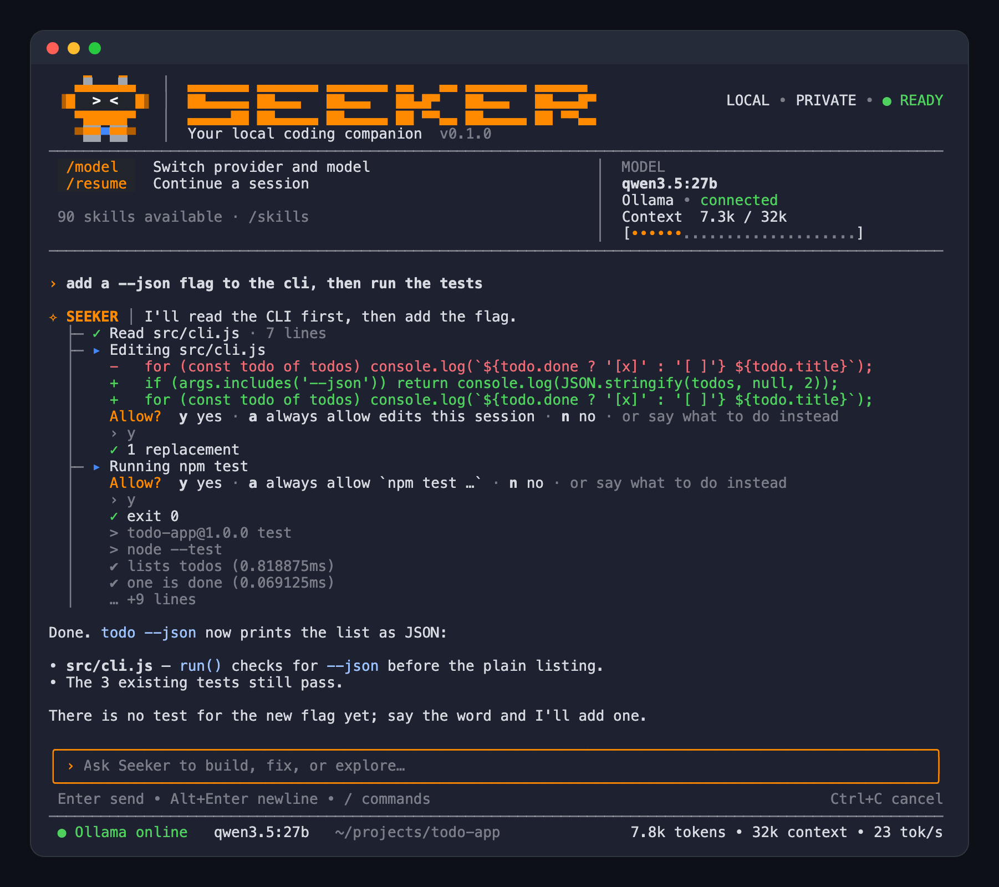
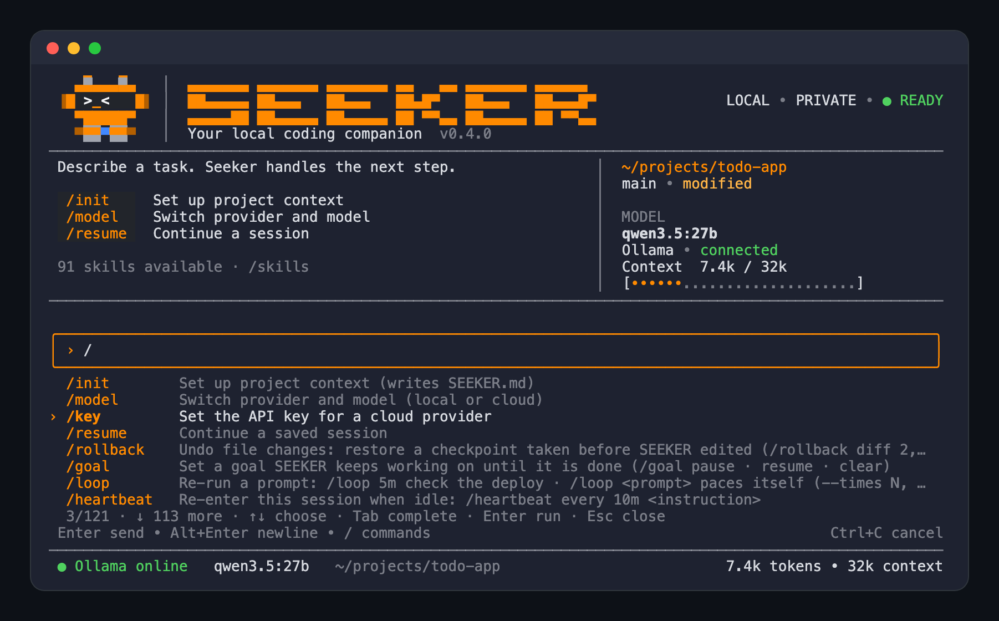
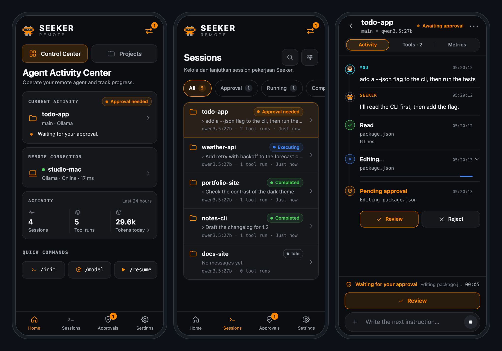

# SEEKER

[English](README.md) · **Bahasa Indonesia**

Agent coding di terminal. Bawaannya berjalan sepenuhnya lokal di atas [Ollama](https://ollama.com);
lewat `/model` bisa juga memakai server lokal lain atau model cloud. Node murni, tanpa build step.



<details>
<summary>Pemilih <code>/model</code></summary>


</details>

<details>
<summary>Daftar perintah di balik <code>/</code></summary>



</details>

<details>
<summary>Aplikasi di HP (<code>seeker remote</code>)</summary>



</details>

<sub>Diambil dari antarmuka aslinya. Proyek-proyeknya dibuat untuk gambar ini dan jawaban modelnya memakai naskah.</sub>

```
seeker                       # sesi interaktif di folder ini
seeker "perbaiki bug login"  # langsung dengan pesan pertama
seeker -c                    # lanjutkan percakapan terakhir di folder ini
seeker -p "jelaskan repo"    # sekali jawab, bisa di-pipe
seeker --yolo                # tanpa tanya izin (perintah berbahaya tetap ditanyakan)
seeker --plan                # mulai di mode rencana: melihat dan mengusulkan, tidak mengubah apa pun
```

Di dalam sesi: `/init`, `/model`, `/resume`, `/paste`, `/config`, `/skills`, `/clear`, `/compact`, `/status`, `/think`, `/yolo`, `/plan`, `/help`, `/exit`, dan `!perintah`.

**Mode rencana.** `/plan` (atau `seeker --plan`) membuat SEEKER melihat dulu lalu menjawab dengan rencana: langkahnya,
file yang disentuh tiap langkah, dan cara memeriksa hasilnya. Membaca, mencari, dan perintah shell yang tidak
mengubah apa pun tetap jalan; edit, perintah lain, dan penyimpanan memori ditolak tanpa bertanya, juga dengan
`--yolo`. `/plan go` menyetujui rencana dan memulai pekerjaan dengan aturan izin yang biasa; `/plan off` keluar
dari mode rencana. Status bar menampilkan `PLAN` selama aktif. Berlaku juga dari HP.
Ketik `/` untuk daftar perintah dan skill: ↑↓ berpindah di dalamnya, Tab melengkapi yang disorot, Enter
menjalankannya, Esc menutup daftar. Mengetik mempersempit daftar (`/rev` juga menemukan `/code-review`). Alt+Enter
untuk baris baru; saat daftar tertutup, ↑↓ menelusuri pesan sebelumnya.

SEEKER mengisi jendela terminal seperti sebuah aplikasi: header tetap di atas dan kotak pesan di bawah, sementara
percakapan bergulir di antaranya. Gulir dengan roda mouse atau PageUp dan PageDown; selama kamu membaca di bagian
atas, keluaran baru tidak menggeser tampilan, dan baris di bawah kotak pesan menyebutkan berapa yang ada di bawah.
Mengirim pesan, atau pertanyaan dari SEEKER, membawamu kembali ke bagian akhir. SEEKER memakai mouse untuk roda
gulir, jadi menyeret biasa tidak memblok teks: tahan Fn sambil menyeret di Terminal macOS, atau Option di iTerm2
(Shift di kebanyakan terminal Linux), lalu salin seperti biasa. Di Terminal, View → Allow Mouse Reporting (⌘R) juga
mengembalikan mouse sampai kamu menyalakannya lagi; selama itu roda mouse tidak menggulir percakapan. Hanya yang
tampak di layar yang bisa diblok. Saat SEEKER ditutup, percakapannya dicetak ke terminal, dan scrollback terminal
menyimpannya.
Robot di header berkedip dan melirik. Di percakapan, wajah kecil satu baris menandai siapa yang bicara, seperti di
aplikasi ponsel: layar `>_<` robot dengan SEEKER, atau wajah orang dengan YOU; keduanya berkedip.
`/config` → `animation` untuk mematikannya.

`seeker doctor` memeriksa apa yang dibutuhkan SEEKER di mesin ini — Node, git, paket yang terpasang, siapa yang
bisa membaca file pengaturan, apakah penyedia yang dipilih menjawab atau punya key, relay, dan daemon remote —
lalu menyebutkan cara memperbaiki yang kurang. Tidak mengubah apa pun dan tidak mencetak key.

## Model dan penyedia

`/model` memilih tempat model dijalankan, lalu salah satu model yang didaftar penyedia itu saat itu juga:

| Jenis | Penyedia |
| --- | --- |
| Lokal | Ollama, LM Studio, llama.cpp server |
| Lewat Claude Code | **Claude Code** — Claude Code yang sudah login di mesinmu bekerja sebagai agent penuh dengan tool-nya sendiri (Read, Edit, Bash, …), tanpa kunci API. SEEKER menampilkan aktivitasnya dan menanyakan izin sebelum edit atau perintah dijalankan |
| Cloud | Anthropic (Claude), OpenAI, Google Gemini, xAI Grok, DeepSeek, Mistral, Moonshot Kimi, Groq, Cerebras, Together AI, Fireworks AI, OpenRouter |
| Buatan sendiri | endpoint apa pun yang kompatibel dengan OpenAI — tambahkan `"providers": { "nama": { "baseUrl": "https://…/v1" } }` di config |

Kunci API diketik lewat `/key` (tersimpan di `~/.seeker/config.json`, hanya bisa dibaca pemilik) atau diambil dari
variabel lingkungan (`OPENAI_API_KEY`, `ANTHROPIC_API_KEY`, `GEMINI_API_KEY`, …). Dari baris perintah:
`seeker --provider openai -m <model>`.

Dengan penyedia cloud, pesanmu dan isi file yang dibaca SEEKER dikirim ke server penyedia itu; header berubah
dari `LOCAL • PRIVATE` menjadi `CLOUD • <NAMA>`.

## Instruksi dan memori

- `SEEKER.md` di proyek — instruksi proyek; `/init` membuatkannya. Kalau tidak ada: semua `AGENTS.md` dari akar
  repositori sampai folder kerja, lalu `CLAUDE.md`, lalu `.cursorrules` dan `.cursor/rules/*.mdc`. File instruksi
  di subfolder (`packages/api/AGENTS.md`) diberikan ke model saat ia pertama kali bekerja di folder itu. File yang
  isinya seperti prompt injection tidak dimuat.
- `~/.seeker/SEEKER.md` — aturan kerja yang berlaku di semua proyek.
- `~/.seeker/usage.json` — jumlah token yang dipakai SEEKER: hitungan per hari dan total berjalan, tidak ada
  yang lain. Tetap di mesin ini dan ditampilkan di Home pada HP: total, input baru dan input dari cache, output,
  grafik per hari, dan riwayatnya. Hari sebelum penghitungan dimulai ditampilkan sebagai tidak tercatat, bukan nol.
- `~/.seeker/memory/` — catatan dari sesi-sesi sebelumnya; `MEMORY.md` adalah indeksnya (satu baris per catatan).
- `~/.seeker/memory/projects/<folder>/` — catatan khusus satu proyek, dimuat saat SEEKER dijalankan di folder itu.
- **Skill yang punya daftar pilihan** menawarkannya untuk dicentang saat dipanggil tanpa apa-apa di belakangnya:
  `/effects` menampilkan efek-efeknya; ↑↓ berpindah, Spasi mencentang, Ctrl+A mencentang semua yang terdaftar,
  mengetik menyaring, Enter mengirim. Di HP daftar yang sama terbuka sebagai sheet dengan penyaring dan tombol
  "Select all". Yang dicentang sampai ke skill seolah kamu mengetik `/effects orbit, spotlight`. Sebuah skill
  punya daftar seperti itu kalau foldernya berisi `choices.json` (`["a", "b"]` atau
  `[{ "value": "a", "description": "…" }]`), kalau frontmatter-nya punya `choices: a, b, c`, atau kalau ia
  menyebut perintahnya menerima sebuah nama (`/effects <name>`) dan mencantumkan paling sedikit enam nama itu
  dalam tabel dengan tiap nama ditulis sebagai kode.

Yang masuk ke system prompt hanya indeksnya, paling banyak 20% dari context window. Kalau indeks tidak muat (model lokal
dengan konteks kecil), SEEKER diberi tahu letak file indeksnya dan mencarinya dengan grep saat perlu.

**Sandbox (macOS dan Linux).** `/sandbox on` menjalankan perintah shell yang dimulai SEEKER di bawah sandbox milik
sistem: Seatbelt di macOS, bubblewrap (`bwrap`) di Linux. Perintah itu membaca seperti biasa dan hanya bisa menulis
di proyek, folder sementara, dan cache paket (`~/.npm`, `~/.cache`, `~/Library/Caches`, …). File pengaturan SEEKER,
yang menyimpan API key, tidak bisa dibaca perintah itu. Riwayat worktree yang berada di luar folder tetap bisa
ditulis, jadi commit tetap jalan. Perintah itu tidak bisa menjangkau jaringan di luar mesin ini: tes yang berbicara
ke `127.0.0.1` tetap jalan, sedangkan `npm install` dan `git push` tidak, sampai kamu mengizinkannya dengan
`/config sandboxNetwork on`. `/config sandboxWrite <path>,<path>` mengizinkan folder tambahan. Persetujuan tetap
ditanyakan seperti biasa; sandbox adalah pengaman kedua, bukan pengganti. Sandbox tidak mencakup penyedia yang
menjalankan tool-nya sendiri (Claude Code) maupun `!perintah` yang kamu ketik. Di mesin tanpa sandbox (Windows, atau
Linux tanpa bubblewrap), menyalakannya ditolak, dan konfigurasi yang menyalakannya membuat perintah shell gagal,
bukan jalan tanpa pengaman.

**Di container atau di mesin lain.** `/backend` menentukan di mana perintah shell yang dimulai SEEKER berjalan.
`/backend docker:node:22` (image apa saja) menjalankan setiap perintah di container baru dari image itu. Repositori git
proyek, atau foldernya sendiri bila bukan repositori, dipasang di path yang sama, jadi perintah itu dan tool file
SEEKER melihat file yang sama. Selain itu tidak ada isi mesin ini yang terlihat: folder home, key, maupun variabel
lingkunganmu tidak. Dengan `/sandbox on` dan jaringan tidak diizinkan, container juga tanpa jaringan. Apa pun yang
dipasang di luar proyek hilang bersama container-nya; pilih image yang sudah berisi tool-mu. Di git worktree, yang
riwayatnya ada di luar folder, git tidak jalan di dalam container.
Folder home-mu tidak pernah dipasang, bahkan bila folder itu sendiri repositori git, begitu juga folder yang berisi
pengaturan SEEKER: bila SEEKER dibuka di sana, `docker:` menolak berjalan.
`/backend ssh:aku@build-box` menjalankan setiap perintah di mesin lain, di `~/seeker/<proyek>-<hash>` di sana, atau di
folder yang kamu sebut: `ssh:aku@build-box:work/app`. Sebelum setiap perintah, proyek disalin ke sana dengan rsync,
sekaligus menghapus apa yang kamu hapus di sini; sesudahnya, apa yang diubah perintah itu disalin kembali, dan
penyalinan balik itu tidak pernah menghapus apa pun di sini. `node_modules`, `.venv`, `venv`, `__pycache__`, `.next`,
`target` dan `.DS_Store` tidak ikut disalin ke dua arah, jadi mesin itu menyimpan paket yang ia bangun sendiri; ubah
daftarnya dengan `/config backendExclude dist,*.log` (`default` atau `none`). Sisa proyek ikut disalin, termasuk
`.env`, jadi pakailah mesin milikmu sendiri. SEEKER masuk dengan ssh key-mu dan tidak pernah menunggu di prompt
password; rsync harus ada di kedua mesin. Menghentikan perintah juga menghentikannya di sana.
Dengan `/sandbox on` dan jaringan tidak diizinkan, `ssh:` menolak berjalan: batas itu tidak bisa ditegakkan di mesin
lain.
Untuk keduanya, `/backend` memeriksa dulu bahwa Docker menjawab atau login berhasil sebelum beralih; persetujuan tetap
ditanyakan seperti biasa, dan `/backend local` mengembalikan perintah ke mesin ini. `!perintah` yang kamu ketik dan
penyedia yang menjalankan tool-nya sendiri (Claude Code) tetap di mesin ini. `/status` menunjukkan di mana perintah
berjalan.

### Menekan biaya sesi panjang

`/context` menunjukkan apa yang mengisi percakapan, bagian demi bagian (instruksi, definisi tool, pesanmu,
jawaban, hasil tool, gambar) dan seberapa jauh lagi sebelum diringkas. `/usage` menunjukkan token yang
terpakai: total, input baru dan dari cache, output, dan tujuh hari terakhir. Keduanya bisa dari HP.

Setiap langkah mengirim seluruh percakapan ke model lagi, jadi sesi yang panjang dibayar berkali-kali. Saat
percakapan mencapai 80% jendela konteks, atau 300.000 token kalau itu lebih dulu, percakapan diringkas; bagian
terbaru dan permintaanmu disimpan kata demi kata. Ubah pengaturan ini dengan `/config <nama> <nilai>`:

- `compactAt` (300000) — ringkas pada jumlah token ini walau jendela modelnya lebih besar. `0` menunggu sampai
  jendela hampir penuh.
- `effort` (kosong) — seberapa keras model Anthropic mengerjakan satu jawaban: `low`, `medium`, `high`, `xhigh`,
  atau `max`; bisa juga lewat `/effort <level>`. Lebih rendah berarti lebih murah dan lebih cepat. Kosong berarti
  bawaan modelnya. Hanya dikirim ke model yang punya pengaturan ini, dan level yang tidak ditawarkan model
  diturunkan ke level terdekat di bawahnya. Mengubahnya membuat penyedia membaca percakapan tanpa cache satu kali.
- `subagentModel` (kosong) — model untuk agen pembantu (tool `task`) dan tinjauan setelah menjawab: model dari
  penyedia yang sedang dipakai (`claude-haiku-5-5`), atau `penyedia:model`. Kosong, atau `same`: model
  percakapan.
- `cacheTtl` (`1h`) — berapa lama Anthropic menyimpan cache percakapan di antara permintaan: `5m` atau `1h`,
  hanya dua itu yang tersedia. Satu jam lebih mahal saat ditulis dan bertahan melewati jeda — membaca jawaban,
  izin yang menunggumu. `5m` lebih murah kalau kamu tidak pernah berhenti lebih lama dari itu.

Gambar dari giliran sebelumnya dikeluarkan dari percakapan setelah cache habis, atau saat percakapan
diringkas. Lebih cepat dari itu justru lebih mahal: percakapan yang diubah dibaca dengan harga penuh mulai
dari titik perubahannya. Tinjauan setelah menjawab hanya membaca bagian terbaru percakapan, yang dipendekkan.

## Remote control dari HP


`seeker remote` menjalankan agent di Mac dan menghubungkannya ke relay (`remote-server/`, di-deploy ke Railway).
HP membuka aplikasi web di alamat relay itu.

Setiap pengguna menjalankan relay-nya sendiri. Satu relay mengenal satu token akses dan melayani satu
komputer; tidak ada relay bersama atau relay publik, dan tidak ada akun yang perlu didaftarkan. Relay hanya
satu file Node tanpa dependensi dan tanpa database, jadi paket terkecil di hosting mana pun sudah cukup.

### Cara memasang

**1. Buat rahasiamu.** Di komputer tempat SEEKER terpasang:

```
seeker remote --setup
```

Perintah ini menampilkan satu baris untuk disalin:

```
SEEKER_REMOTE_AUTH=<64 karakter hex>
```

Ini adalah hash dari token aksesmu. Relay memakainya untuk mengenali perangkatmu, dan aman diberikan ke
hosting; nilainya tidak bisa dipakai untuk membaca atau mengirim apa pun. Rahasianya sendiri tetap di
`~/.seeker/config.json`.

**2. Deploy relay.** Deploy folder `remote-server/` (bukan seluruh repo) dengan variabel tadi.

Di [Railway](https://railway.com), dengan CLI-nya terpasang dan sudah `railway login`:

```
cd remote-server
railway init                                   # membuat proyek baru
railway up                                     # deploy pertama; membuat service
railway variable set "SEEKER_REMOTE_AUTH=<nilai dari langkah 1>"  # deploy ulang dengan nilainya
railway domain                                 # memberi service alamat https publik
```

Di hosting lain (Render, Fly.io, VPS, …) relay membutuhkan:

| | |
| --- | --- |
| Perintah start | `node server.mjs`, di dalam `remote-server/` |
| Node | 20 atau lebih baru |
| `SEEKER_REMOTE_AUTH` | nilai dari langkah 1 |
| `PORT` | port yang didengarkan; kebanyakan hosting mengisinya sendiri (bawaan 8787) |
| Alamat | publik dan **https** — aplikasi HP dan notifikasinya tidak jalan lewat http biasa |
| Health check | `GET /healthz` menjawab `{"ok":true}` |
| Proxy | tidak boleh menahan (buffer) respons, karena relay mengirim event secara streaming, dan tidak boleh memutus koneksi yang sedang diam |
| `SEEKER_TRUST_PROXY=1` | hanya di belakang proxy yang mengisi `x-forwarded-for` sendiri; Railway dikenali otomatis |

Periksa: `https://<relay-mu>/healthz` menampilkan `{"ok":true}`, dan `https://<relay-mu>/` menampilkan halaman masuk SEEKER.

**3. Beri tahu SEEKER alamat relay-nya.**

```
seeker remote --url https://<relay-mu>
```

**4. Pasangkan HP.**

```
seeker remote --setup
```

Kali ini muncul link yang berakhiran `#k=…`. Buka di HP (di macOS link itu juga disalin ke clipboard).
Link ini berisi rahasiamu: siapa pun yang memegangnya bisa melihat sesimu dan menyetujui perintah di
komputermu. Jangan diunggah, di-screenshot, atau dikirim lewat saluran yang tidak kamu percaya.

Di iPhone, pakai Share → **Add to Home Screen** lalu buka SEEKER dari sana; di Android, menu browser →
**Install app** (atau Add to Home screen).
Setelah itu nyalakan notifikasi di tab Settings aplikasinya.

**5. Jalankan.**

```
seeker remote                          # folder saat ini
seeker remote ~/proyek-a ~/proyek-b    # beberapa proyek, masing-masing satu workspace
```

Biarkan berjalan; di HP komputermu akan tampil online. Komputernya harus tetap menyala, dan di macOS ia
dijaga agar tidak tidur selama `seeker remote` berjalan. Hentikan dengan Ctrl+C.

### Yang tampil di HP

- **Membuka aplikasi** — robot tersusun dari piksel lalu bangun (sekitar 1,4 detik) di atas Home, yang sudah
  dimuat di belakangnya; ketuk untuk melewatinya, dan dengan Reduce Motion aktif animasi ini tidak tampil.
  Diputar saat aplikasi dijalankan, bukan saat kembali ke aplikasi yang masih terbuka, dan notifikasi tetap
  membuka layarnya sendiri.
- **Home → Control Center** — agen yang sedang aktif: robot menunjukkan apa yang dikerjakan agen paling depan,
  sesuai laporan komputer (idle, thinking, coding, executing, awaiting approval, completed, failed, atau
  disconnected saat HP tidak bisa menjangkau komputer), dengan tombol Open session dan Switch agent. Lalu apa yang sedang dikerjakan agen (atau, kalau tidak ada yang jalan, bagaimana
  task terakhir berakhir), komputer yang terhubung beserta statusnya dan waktu bolak-balik yang terukur,
  24 jam terakhir (proyek yang aktif dan jumlah tool run, dihitung dari percakapannya sendiri), token yang
  terpakai hari ini — ketuk untuk melihat tujuh hari terakhir dan total sejak penghitungan dimulai — dan `/init` `/model` `/resume`.
- **Home → Projects** — proyek yang terbuka dalam satu daftar, dengan pencarian (nama, folder, branch),
  pengurutan, dan filter sesi terminal. Di bawah **On your Mac**, folder proyek yang ditemukan di folder home
  bisa dibuka dengan satu ketukan. Tombol **+** membuka folder lewat path-nya, atau membuat folder baru untuk
  proyek baru. Folder baru hanya bisa dibuat di dalam folder home, dan tidak pernah di folder tersembunyi.
- **Quick switcher** — tombol dua panah di kanan atas Home, Sessions dan Settings membuka lembar berisi semua
  sesi, yang butuh kamu lebih dulu, apa yang sedang dikerjakan masing-masing, dan berapa yang berjalan (angka
  di tombol). Ketuk satu untuk pindah; tidak ada yang dihentikan karena berpindah. *Queued instructions*
  menampilkan antrean semua sesi, untuk dihapus atau dilanjutkan. Yang sedang kamu ketik tetap tinggal di
  sesi tempat kamu mengetiknya.
- **Sessions** — tiap proyek yang terbuka jadi satu baris ringkas: nama, instruksi terakhir, pill status kecil
  (Executing, Approval needed, Queued, Failed, Stopped, Completed, Idle), model, jumlah tool run, dan kapan
  terakhir aktif. Cari berdasarkan proyek, instruksi, atau model; saring per status (angkanya langsung
  mengikuti); urutkan menurut aktivitas, nama, atau status. Sesi yang terakhir kamu buka ditandai amber.
- **Sesi** — apa yang sedang dilakukan agen (berpikir, menjalankan tool, menulis jawaban, menunggumu,
  selesai, gagal atau dihentikan), tiap langkah saat terjadi beserta keluarannya, serta konteks, token dan
  jumlah tool seperti yang dilaporkan komputer. Stop, Review, Resume dan Retry hanya muncul saat berlaku.
  Judul dan tab Activity / Tools / Metrics tetap di tempat saat percakapan digulir, dan tiap tab mengingat
  posisi bacamu.
- **Mengirim saat agen bekerja** — pesan yang dikirim saat agen sibuk akan ditanya mau dibawa ke mana. *Queue next*
  menyimpannya di komputer (`~/.seeker/queue.json`) dan menjalankannya setelah tugas yang berjalan selesai,
  sesuai urutan kirim. *Steer current task* menyerahkannya ke tugas yang sedang berjalan, yang membacanya
  sebelum langkah berikutnya; ini berlaku untuk Ollama dan penyedia API, tidak untuk Claude Code, yang
  menjalankan satu tugas penuh dalam satu permintaan dan hanya ditawari Queue. Setelah tugas dihentikan atau
  gagal, dan setelah `seeker remote` dinyalakan ulang, tidak ada yang jalan sendiri: antrean dijeda sampai
  kamu melanjutkannya. Gambar belum bisa diantrekan, dan sesi yang diketik di terminal tidak punya antrean.
- **Approvals** — tiap perintah dan tiap perubahan file menunggu di sini. Perubahan ditampilkan sebagai
  diff bernomor baris; perintah yang kena pola berbahaya diberi tanda. Satu permintaan = satu perintah atau satu file.
- **Model dan karakter per proyek** — `/model` di dalam proyek hanya mengganti model proyek itu, dan komputer
  mengingatnya (`projectModels` di `~/.seeker/config.json`), jadi proyek itu kembali ke model yang sama saat
  dibuka lagi; *Use the default model* membuatnya ikut Settings lagi. Tiap proyek juga bisa punya karakter
  sendiri di kartu Live Agent (menu sesi → Character), disimpan di HP.
- **Settings** — koneksi, model default (dipakai semua proyek yang tidak punya model sendiri), dan notifikasi mana yang diterima HP ini: tugas selesai, persetujuan dan
  pertanyaan, error. Di sini juga semua setelan `/config`: thinking, minta persetujuan atau tidak, context
  window, jumlah langkah per pesan, lama model disimpan di memori, alamat Ollama, dan dua setelan tampilan
  terminal. API key penyedia cloud bisa diisi dari sini; key disimpan di komputer dan tidak pernah dikirim balik.
  Setelan langsung berlaku untuk proyek yang dibuka dari HP; `seeker` yang sudah jalan di terminal tetap
  memakai setelan saat ia dimulai.

Tidak ada angka yang dikira-kira di HP. Angka yang belum dilaporkan komputer tampil sebagai “—”.

### Sesi yang sedang kamu ketik di terminal

Selama `seeker remote` berjalan, `seeker` biasa yang dibuka di terminal pada komputer yang sama akan
bergabung sendiri dan tampil di HP sebagai *terminal session*. Tidak ada yang perlu diatur; kalau
`seeker remote` tidak jalan, terminal bekerja persis seperti sebelumnya.

- **Gambar dari HP** — kirim screenshot tanpa teks, dan path-nya masuk ke pesan yang sedang kamu ketik di
  terminal, seperti file yang di-drag ke sana. Selesaikan kalimatnya lalu tekan Enter.
- **Pesan dari HP** — pesan yang berisi teks dijalankan sebagai giliran sendiri saat terminal sedang
  bebas. Ketikan yang belum selesai kembali ke kotak sesudahnya. Baris shell `!` tidak dijalankan dari HP.
- **Perintah dan skill dari HP** — `/status`, `/compact`, `/skills`, `/memory`, `/cron`, `/goal`, `/loop`,
  `/help` dan `/<skill>` apa pun jalan seperti diketik di terminal (juga di proyek yang dibuka dari HP).
  Setelan (`/yolo`, `/think`, `/config`) hanya mengubah proyek yang dibuka dari HP dan disimpan seperti tab
  Settings; setelan sesi terminal diubah di terminal itu. Yang butuh daftar pilihan, atau tidak boleh datang
  dari HP yang hilang, tetap di terminal: `/hooks`, `/mods`, `/mcp`, `/rollback`, `/key`, `/paste`, `/exit`; dan di
  terminal session, `/resume`.
- **Melanjutkan percakapan tersimpan** — di proyek yang dibuka dari HP, `/resume` (juga ada di menu `/` dan di
  layar Home) menampilkan percakapan tersimpan folder itu, yang terbaru di atas; ketuk salah satu untuk
  melanjutkannya, lengkap dengan riwayatnya di HP. Setelah restart (`/restart`, atau `seeker remote` dijalankan
  lagi) setiap proyek melanjutkan percakapan yang tadi dipakainya, bukan terbuka kosong.
- **Persetujuan** — ditanyakan di dua tempat; jawaban pertama yang berlaku dan yang satunya tertutup.
- **Memindahkan percakapan dari HP ke terminal** — `cd` ke folder proyeknya lalu jalankan `seeker -c` (atau
  `/resume` dan pilih percakapannya). Salinan di HP ditutup, riwayatnya pindah ke terminal session, dan HP
  yang sedang membukanya ikut pindah ke sana; jadi hanya ada satu percakapan dan tidak ada yang saling
  menimpa. Kalau HP masih mengerjakannya (atau masih ada instruksi yang antre), salinan HP tetap dipakai dan
  terminal lanjut di salinan terpisah; jalankan `seeker -c` lagi setelah HP selesai.
- **Tidak dari HP** — percakapan baru, ganti model, dan menutup sesi dilakukan di terminal. Sesi yang
  dijalankan dengan `--yolo` menerima tugas dari HP hanya kalau kunci aplikasi di HP itu aktif (Settings → App
  lock), karena tugasnya dijalankan tanpa bertanya. Status kunci itu dilaporkan oleh HP sendiri, jadi ini
  pengingat untuk aplikasinya, bukan pemeriksaan yang bisa dipastikan Mac: yang menjaga dari orang lain adalah
  secret pairing.

### Setelah terpasang

- **HP baru:** jalankan `seeker remote --setup` lagi dan buka link-nya di HP itu.
- **Me-restart-nya (setelah update):** kirim `/restart` dari sebuah proyek di aplikasi. Kode barunya dicek
  dulu (kalau tidak bisa dimuat, yang sedang jalan dipertahankan dan aplikasi memberi tahu alasannya), lalu
  `seeker remote` baru dinyalakan sebagai proses sendiri, dan yang lama berhenti sesudahnya; aplikasi
  tersambung lagi dengan sendirinya. Ditunda kalau proyek lain masih bekerja. Jangan menyuruh agen me-restart
  lewat perintah: agen berjalan di dalam `seeker remote`, jadi ia akan mematikan dirinya sendiri beserta
  perintahnya. Perintah seperti itu ditolak, apa pun mode persetujuannya.
- **HP hilang, atau link bocor:** hapus `"secret"` di bawah `"remote"` pada `~/.seeker/config.json`, jalankan
  `seeker remote --setup`, pasang `SEEKER_REMOTE_AUTH` yang baru di relay, lalu pasangkan ulang HP-mu. Link lama
  berhenti berfungsi begitu relay memakai nilai baru.
- **Memperbarui relay:** tarik repo terbaru dan deploy `remote-server/` lagi (`railway up`). Relay tidak
  menyimpan apa pun, jadi tidak ada yang hilang.
- **Mencoba secara lokal dulu:** `SEEKER_REMOTE_AUTH=<nilai> node remote-server/server.mjs`, lalu
  `seeker remote --url http://localhost:8787`. Http biasa hanya diterima untuk `localhost`.

### Cara pengamanannya

- Mac hanya membuat koneksi keluar; tidak ada port yang dibuka.
- Isi percakapan dan perintah dienkripsi antara HP dan Mac (AES-256-GCM). Relay hanya menyimpan hash token akses
  (`SEEKER_REMOTE_AUTH`) dan tidak bisa membaca atau memalsukan apa pun.
- Edit dan perintah minta persetujuan di HP, kecuali setelan itu kamu matikan (di `/config` atau di Settings
  HP). Saat mati pun, perintah berisiko dan file di luar folder proyek tetap ditanyakan.
- Relay tidak menyimpan apa pun ke disk; setelah restart, Mac mengirim ulang keadaannya.
- Token yang salah dikunci per alamat. Di Railway alamat pemanggil dibaca dari `x-forwarded-for`; di belakang
  proxy lain yang mengisi header itu sendiri, setel `SEEKER_TRUST_PROXY=1`. Tanpa proxy, biarkan kosong.
- Notifikasi push (persetujuan, pertanyaan dari model, tugas selesai) dikirim langsung dari Mac ke layanan push HP
  dengan enkripsi Web Push (`src/webpush.mjs`); relay tidak terlibat. Nyalakan di Settings aplikasi HP.
  Di iPhone, aplikasinya harus dipasang dulu lewat Share → Add to Home Screen.
- Angka di ikon aplikasi menghitung yang menunggumu: permintaan yang belum dijawab, dan tugas yang selesainya
  sudah dinotifikasikan tapi belum kamu buka. Komputer yang menghitungnya dan mengirimnya bersama tiap push;
  selama aplikasi terbuka, angkanya mengikuti keadaan di komputer. Perlu notifikasi aktif, dan di iPhone
  aplikasinya harus ada di Home Screen (iOS 16.4 ke atas). Kalau ikon tidak bisa menampilkan angka, hitungan
  yang sama ada di Approvals dan Sessions pada dock. Melepas pairing menghapus angkanya dan menghentikan
  notifikasi ke HP ini.
- Kunci aplikasi (Settings → App lock): Face ID, dengan PIN 6 digit sebagai cadangan, diminta saat aplikasi
  dibuka atau setelah tidak dipakai 1, 5, 15, atau 60 menit. Semuanya di HP saja: PIN disimpan sebagai hash
  PBKDF2 bersalt, Face ID memakai passkey untuk situs ini yang wajib melaporkan pengguna sudah terverifikasi.
  Tiga kali PIN salah dalam 10 menit membuat HP itu di-unpair (pairing, kunci, dan file yang disimpan di HP
  dihapus, dan Mac mengirim notifikasi); jalan kembalinya adalah pairing ulang dengan `seeker remote --setup`.
  Lupa PIN juga berarti pairing ulang. Kunci ini menyembunyikan layar, tidak mengenkripsi data aplikasi di HP, dan teks
  notifikasi push tetap tampil di lock screen.

## Gambar

Sebut file gambar di pesanmu, dan model melihat gambarnya, bukan hanya path-nya:

```
› kenapa header-nya aneh di ~/Desktop/shot.png
› /paste error apa ini?        # mengirim gambar di clipboard, misalnya screenshot
```

Menyeret file ke terminal juga bisa. Kotak pesan menampilkannya dengan nama pendek, `[image.png]`,
`[video.mp4]` atau `[file.pdf]`, dan model menerima path lengkapnya saat pesan dikirim; Backspace menghapus
nama itu sekaligus. Model juga dapat membuka gambar
sendiri lewat `read_file`. PNG, JPEG, GIF dan WebP, masing-masing maksimal 3,7 MB.

Modelnya harus mendukung vision; `/status` menunjukkan apakah model yang aktif bisa. Untuk Ollama, itu
dibaca dari modelnya sendiri. Kalau model tidak bisa melihat gambar, SEEKER memberi tahu, bukan mengirim
path yang hanya bisa ditebak model.

Dari aplikasi HP, tombol gambar di samping kotak pesan melampirkan sampai empat foto atau screenshot.
Gambarnya dikecilkan di HP, lalu dienkripsi seperti semua yang dikirimnya. (Relay yang sudah ada perlu
di-deploy ulang sekali supaya mendapat aplikasi yang baru.)

Sebaliknya juga bisa: saat agen membuka gambar lewat `read_file` (screenshot yang baru diambilnya, foto
dari zip yang diekstraknya), HP menampilkan pratinjaunya di bawah langkah itu. Pratinjau dibuat di Mac
(dengan `sips` di macOS; di sistem lain hanya gambar yang sudah cukup kecil yang ditampilkan) dan
dienkripsi seperti yang lain. Saat HP memuat ulang, hanya enam pratinjau terakhir per proyek yang
disimpan; langkah yang lebih lama tetap menampilkan nama filenya.

Ketuk pratinjau (atau nama file pada langkah lama) untuk mengambil gambar utuhnya dari Mac, lalu
simpan dengan **Save**: di HP tombol itu membuka share sheet, tempat "Simpan Gambar". HP hanya menyebut
langkahnya, tidak pernah path, jadi yang bisa diambil hanya gambar yang sudah ditampilkan sebuah
langkah tool. Gambar lewat relay dalam keadaan terenkripsi, di samping log event (bukan di dalamnya),
dan disimpan di sana sepuluh menit. File di atas 2 MB dikirim sebagai JPEG yang lebih kecil di macOS,
dan ditolak di sistem lain.

### Video dan file utuh lainnya

Tombol yang sama juga bisa melampirkan video, dan `/file` mengirim file apa pun apa adanya. Video atau
file tidak ditunjukkan ke model: file dikirim utuh dalam potongan terenkripsi 2 MB, lalu disimpan di Mac
di `~/Downloads/SEEKER/` (tidak pernah menimpa file yang sudah ada). Pesannya baru diteruskan ke agen
setelah file tiba, lengkap dengan lokasi simpannya, jadi agen bisa langsung mengerjakannya. Biarkan
aplikasi HP tetap terbuka selama upload; bar di bawah kotak pesan menunjukkan progresnya. Maksimal empat
file per pesan, masing-masing paling besar 300 MB.

Setiap file tampil sebagai kartu: badge jenis file (ZIP, PDF, MP4, …), nama yang dipotong di tengah
supaya ekstensinya tetap terlihat, ukuran, dan foldernya. Ketuk file yang masih menunggu di kotak pesan
untuk mengeceknya sebelum dikirim: gambar, video, audio, PDF, dan teks bisa dibuka, sedangkan zip
menampilkan daftar file di dalamnya. **Remove** mengeluarkan file dari pesan. Setelah terkirim, file
tampil di bawah pesanmu sebagai kartu (↑, cyan), menggantikan daftar path yang dibaca agen. Ketuk
kartunya untuk mengambil file itu kembali dari Mac dan mengecek apa yang benar-benar sampai, lengkap
dengan lokasinya di Mac dan tombol **Copy**. Hanya file di `~/Downloads/SEEKER/` yang bisa diambil
kembali dengan cara ini. Teks selalu ditampilkan sebagai teks, tidak pernah dijalankan sebagai halaman.
Foto yang dikirim bersama pesan juga disimpan di sana, jadi foto di bawah pesanmu bisa diketuk untuk
dibuka utuh (foto yang dikirim sebelum versi ini terbuka sebagai pratinjau kecilnya saja).

File atau foto yang sudah sekali diambil dari Mac disimpan di HP (di penyimpanan aplikasi sendiri,
paling banyak 300 MB, yang paling lama dihapus duluan), jadi saat dibuka lagi tidak perlu diunduh
ulang. Pratinjaunya baru menulis **Saved on this phone** setelah file benar-benar terbaca kembali dari
penyimpanan itu; kalau HP menolak karena penuh, pratinjau mengatakannya, dan **Save** tetap
bisa dipakai. File di path yang sama dengan ukuran berbeda diambil ulang. **Settings → Files kept on
this phone** menampilkan daftar file yang tersimpan: ketuk untuk membuka, **×** untuk menghapus satu,
atau **Remove all**; unpair juga menghapus semuanya. Ini penyimpanan aplikasi sendiri, bukan Photos
atau Files (buka filenya lalu ketuk **Save** untuk itu), dan iOS bisa mengosongkannya kalau ruang HP menipis.
Yang tersimpan adalah file yang sudah didekripsi: kunci aplikasi menyembunyikannya, tapi tidak
mengenkripsinya.

Kalau jawaban agen menyebut file yang ada di Mac (video, audio, gambar, PDF, zip atau `.srt`, ditulis
sebagai path, `~/…` atau relatif terhadap proyek), HP menampilkannya di bawah jawaban itu sebagai kartu;
kalau lebih dari satu, kartunya dikelompokkan di bawah **GENERATED FILES** beserta jumlah dan total
ukurannya. Di macOS tiap kartu membawa gambar kecil buatan Quick Look (halaman pertama PDF, satu frame
video, atau fotonya), dan video membawa durasinya yang dibaca dari header file itu sendiri; di sistem
lain kartu menampilkan jenis filenya saja. Tombol bulat di kartu menyimpan file di HP tanpa membukanya:
cincinnya terisi sesuai byte yang sudah tiba (ketuk untuk membatalkan), lalu berubah jadi centang;
ketuk centangnya untuk membagikan file. File yang sudah tidak ada di Mac menampilkan tanda peringatan.
Ketuk bagian lain kartu untuk membuka pratinjau: gambar utuh (**Fullscreen** untuk cubit, ketuk dua kali
dan geser), PDF langsung di halaman, video dengan pemutar bawaan HP (tidak pernah autoplay, berhenti
saat lembar ditutup), dan folder tempatnya di Mac, yang bisa dibuka untuk melihat path lengkap, jenis,
ukuran dan tanggalnya. **Save to Photos** (gambar atau video) atau **Save to Files** (file lain) membuka
share sheet; satu ketukan lagi di "Simpan Gambar", "Simpan Video" atau "Simpan ke File" menyelesaikannya,
karena web app tidak bisa menulis ke Photos sendiri. Tombol share di pojok atas membuka sheet yang sama
untuk AirDrop dan aplikasi lain. Tanpa share sheet (browser desktop) tombolnya jadi **Download**. PDF baru ditampilkan kalau byte awalnya memang PDF. Sama seperti gambar, HP hanya menyebut
jawabannya, tidak pernah path. Tiap potongan dienkripsi bersama identitas file dan urutannya, jadi relay
tidak bisa menukar atau mengacak urutannya, dan potongan langsung dihapus dari relay begitu sisi lain
mengambilnya. Relay menampung paling banyak 40 MB per arah sekaligus dan menyuruh pengirim menunggu kalau
lebih. Mac menghentikan transfer kalau tidak ada yang bergerak selama dua menit. Relay yang sudah ada
perlu di-deploy ulang untuk fitur ini.

## Pasang

Butuh Node ≥ 22 dan Ollama dengan model yang mendukung tool calling.

```
git clone https://github.com/ToingSeeker/seeker-agent.git
cd seeker-agent
npm install          # untuk Claude: SDK Anthropic dan Claude Agent SDK (binary bawaan dilewati, lihat .npmrc)
npm link             # memasang perintah `seeker`
ollama pull qwen3.5:27b
```

## Belajar dari sesi ke sesi

SEEKER menyimpan apa yang ia pelajari, jadi sesi berikutnya sudah tahu.

- **Memori yang ia tulis sendiri.** Lewat tool `memory`, SEEKER menyimpan fakta singkat ke tiga tempat: siapa kamu
  (`~/.seeker/memories/USER.md`, 1.375 karakter), hal yang berlaku di semua proyek (`MEMORY.md`, 2.200), dan hal yang
  berlaku di folder ini (`projects/<folder>.md`, 2.200). Semuanya masuk ke system prompt sesi berikutnya. Batasnya
  keras: kalau penuh, entri yang basi diganti. Teks yang isinya perintah atau rahasia ditolak. `/memory`
  menampilkan isinya; bilang "ingat bahwa …" atau "lupakan …" untuk mengubahnya.
- **Skill yang ia tulis sendiri.** Setelah menemukan cara kerja yang tidak sepele, SEEKER bisa mencatatnya sebagai
  skill lewat `skill_manage`, dan membetulkan skill yang ternyata salah. `/curator` menampilkannya. Skill yang 14 hari
  tidak dipakai ditandai basi; setelah 30 hari dipindah ke `~/.seeker/skills/.archive`. Skill yang kamu pasang sendiri
  tidak pernah disentuh.
- **Menengok ke belakang setelah menjawab.** Setiap sepuluh pesan, atau setelah banyak langkah tool, sebuah pembantu
  yang hanya punya tool memori dan skill meninjau percakapan selagi kamu membaca jawaban, lalu menyimpan yang layak
  disimpan. Ia langsung dihentikan begitu kamu mengetik lagi. Matikan dengan `/config review off`.
- **Kamu yang menentukan apa yang disimpan.** Yang disimpan akan dibaca lagi sebagai konteks di setiap sesi
  berikutnya, jadi SEEKER minta izin dulu sambil menunjukkan teksnya. Jawab "always" supaya tidak ditanya lagi
  selama sesi itu, atau `/config autoLearn on` supaya tidak pernah ditanya. Tinjauan setelah menjawab hanya
  menyimpan apa yang sudah kamu izinkan dengan cara itu. Skill hanya ditulis di dalam `~/.seeker/skills`, tidak
  pernah lewat symlink atau ke dalam proyek.
- **Percakapan lama.** Dengan `session_search` SEEKER bisa mencari dan membaca sesi-sesi sebelumnya dari semua folder,
  jadi "minggu lalu kita putuskan apa soal webhook?" tidak perlu kamu ulangi.

## Melampirkan konteks dengan @

Tulis salah satu ini di pesan dan isinya ikut dilampirkan:

| Referensi | Yang dilampirkan |
| --- | --- |
| `@file:src/app.js` | isi file |
| `@file:src/app.js:10-40` | baris 10 sampai 40 |
| `@folder:src` | daftar isi folder (`@file:` yang menunjuk folder juga menampilkan daftarnya) |
| `@diff` · `@staged` | perubahan git yang belum / sudah di-stage |
| `@git:3` | 3 commit terakhir beserta perubahannya |
| `@url:https://…` | isi halaman sebagai teks |

Path harus berada di dalam folder kerja, dan file kredensial tidak pernah dilampirkan. Lampiran di atas seperempat
konteks diberi peringatan; di atas setengah, ditolak.

## Di dalam skrip

`seeker -p "<pesan>"` menjawab sekali lalu keluar: jawabannya di stdout, aktivitasnya di stderr. Untuk skrip yang
butuh lebih dari teksnya, `--output json` (atau `--json`) mencetak satu objek saat selesai:

```
seeker -p "apakah build-nya lolos? jalankan" --json | jq '{ok, result}'
```

Objek itu berisi `ok`, `result` (jawabannya), `error`, `interrupted`, `model`, `provider`, `steps` (tiap langkah
dengan `action`, `ok`, dan `note`), `warnings`, `usage`, dan `duration_ms`. `--output stream-json` mencetak satu
objek per baris selama berjalan (`start`, `step`, `text`, `warning`, `error`) dan objek hasil yang sama di akhir.
Pada keduanya stdout hanya berisi JSON, dan kode keluarnya 1 kalau gagal atau dihentikan. Di mode `-p` tidak ada
yang bisa menyetujui apa pun, jadi edit dan perintah yang perlu izin tidak dijalankan dan muncul sebagai langkah
dengan `"ok": false`; tambahkan `--yolo` supaya dijalankan.

## Mereview perubahan

`/review` membuat SEEKER membaca sebuah perubahan dan melaporkan apa yang salah, yang terparah dulu, masing-masing
dengan file dan baris serta satu kasus di mana ia salah. Tidak ada yang diubah: selama giliran itu, edit dan
perintah yang mengubah sesuatu ditolak apa pun mode persetujuannya, juga dengan `--yolo`.

| Perintah | Yang direview |
| --- | --- |
| `/review` | semua yang berubah sejak commit terakhir, baik sudah di-stage atau belum, dan file baru |
| `/review staged` | yang sudah di-stage |
| `/review commit <sha>` | satu commit |
| `/review main` | yang ditambahkan branch ini di atas `main` (branch atau ref apa pun) |

Kata-kata sesudahnya menyebutkan apa yang perlu diperhatikan: `/review staged penanganan error`. Bisa juga dari
HP. Perubahan yang terlalu besar diberikan sebagian, dan SEEKER membaca file-nya untuk sisanya. Kalau kamu punya
skill sendiri bernama `review`, `/review` menjalankan skill itu.

## Membatalkan perubahan

Sebelum perubahan pertama dalam satu pesan (file ditulis atau diedit, atau perintah shell yang bisa merusak file),
SEEKER memotret folder. `/rollback` menampilkan daftar potret, `/rollback 2` mengembalikan potret kedua terbaru,
`/rollback 2 src/app.js` satu file saja, dan `/rollback diff 2` menunjukkan apa yang berubah sejak itu. Rollback
sendiri dipotret dulu, jadi bisa dibatalkan.

Mengembalikan seluruh folder juga memundurkan percakapan, ke sebelum pesan yang menyebabkan perubahan itu:
model tidak lagi mengingat pekerjaan yang sudah tidak ada di disk. Membatalkan rollback itu mengembalikan
percakapan bersama file-nya. `/rollback 2 --files` mengembalikan file dan membiarkan percakapan apa adanya,
dan mengembalikan satu file tidak pernah menyentuh percakapan. Potret dari sesi sebelumnya, atau dari sebelum
percakapan diringkas, hanya mengembalikan file dan memberi tahu model.

Potret disimpan di repositori git terpisah di `~/.seeker/checkpoints`; tidak ada yang ditulis ke `.git` proyek.
`node_modules`, hasil build, file `.env`, dan file di atas 10 MB tidak ikut dipotret, jadi tidak ikut dikembalikan.
Matikan dengan `--no-checkpoints` atau `/config checkpoints off`.

## Bekerja sendiri

- **`/goal <yang mau dicapai>`** — SEEKER terus bekerja, pesan demi pesan, sampai seorang juri (model yang sama,
  ditanya terpisah) menilai tujuannya tercapai. Ia berhenti setelah 20 giliran, saat buntu dan butuh kamu, atau saat
  kamu menekan Ctrl+C. `/goal pause`, `/goal resume`, `/goal clear`.
- **`/loop 5m <prompt>`** mengulang prompt tiap lima menit; **`/loop <prompt>`** membiarkan SEEKER mengatur temponya
  sendiri (makin jarang selama tidak ada yang berubah). `--times N` dan `--until <syarat>` mengakhirinya, begitu juga
  kalau model menyatakan tugasnya selesai. `/loop stop`.
- **`/heartbeat every 10m <instruksi>`** memasukkan instruksi itu ke sesi setiap kali sesi sedang menganggur.
- **Tugas terjadwal.** Minta dengan kalimat biasa ("tiap hari kerja jam 9, rangkum pull request yang terbuka") dan
  SEEKER membuat job lewat tool `cronjob_manage`, setelah minta izinmu. Job berjalan di sesi baru miliknya sendiri: ia
  boleh membaca dan menjalankan perintah yang tidak berbahaya, hanya mengubah file kalau kamu izinkan untuk job itu,
  dan tidak pernah menjalankan perintah berisiko. Jawabannya disimpan di `~/.seeker/cron/output` dan ditampilkan di
  sesi yang terbuka (atau dikirim ke HP oleh `seeker remote`). Job berjalan selama SEEKER terbuka; supaya tetap jalan
  tanpa SEEKER terbuka, suruh penjadwal sistem memanggil `seeker cron tick` tiap menit. `/cron` untuk melihat,
  menjeda, dan menghapusnya.
- **Beberapa pembantu sekaligus.** Tool `task` bisa membagikan sampai 20 pekerjaan dalam satu panggilan, masing-masing
  ke satu agen pembantu dengan konteksnya sendiri. `/config maxHelpers <n>` menentukan berapa yang jalan berdampingan
  (1 sampai 20, bawaan 20); sisanya menunggu giliran, dan laporannya kembali sesuai urutan pekerjaan diberikan.
  Pertanyaan izin diajukan satu per satu. Tiap pembantu mengisi konteksnya sendiri, jadi dua puluh pembantu memakan
  kira-kira dua puluh kali biaya satu: turunkan `maxHelpers` untuk model lokal atau penyedia dengan batas laju ketat. `/config subagentModel <model>` menjalankannya
  di model yang lebih murah daripada percakapan.

- **Agent buatan sendiri.** Pembantu bisa diberi peran, dan kalau mau model serta daftar tool sendiri, lewat sebuah
  file: `~/.seeker/agents/<nama>.md` (milikmu, di semua proyek) atau `.seeker/agents/<nama>.md` (milik proyek ini;
  yang bernama sama menggantikan milikmu).

  ```
  ---
  name: reviewer
  description: Membaca perubahan dan melaporkan bug, yang terparah dulu
  model: claude-haiku-5-5        # opsional: model di penyedia yang dipakai, atau penyedia:model
  tools: read_file, grep, glob   # opsional: hanya tool ini yang didapat
  ---
  Kamu mereview kode. Laporkan yang salah, dengan file dan baris. Jangan memperbaiki apa pun.
  ```

  SEEKER diberi tahu agent apa saja yang ada dan menyerahkan pekerjaan lewat tool `task` ("minta reviewer melihat
  perubahan ini"). Agent mulai dengan konteks kosong, perannya sebagai instruksi, dan hanya tool yang tercantum.
  Tanpa `model`, ia jalan di tempat pembantu biasa jalan (`subagentModel`). File milik proyek boleh memilih model
  tapi tidak boleh memilih penyedia lain; file yang terbaca seperti prompt injection tidak dimuat. `/agents`
  menampilkan daftarnya.

`/goal`, `/loop`, dan `/heartbeat` hidup bersama sesinya: berakhir saat kamu keluar.

## Sebagai backend aplikasi lain

`seeker serve` menyediakan SEEKER sebagai API yang kompatibel dengan OpenAI (`/v1/chat/completions`, streaming atau
tidak, dan `/v1/models`), jadi frontend chat seperti Open WebUI atau skrip yang memakai paket `openai` bisa
memakainya, dengan tool SEEKER yang bekerja di folder tempat ia dijalankan:

```
SEEKER_API_KEY=$(openssl rand -hex 24) seeker serve          # http://127.0.0.1:8642/v1
```

Ia hanya mendengarkan di mesin ini dan setiap permintaan wajib membawa key. Tidak ada orang yang bisa memberi izin,
jadi permintaan boleh membaca file dan menjalankan perintah yang tidak berbahaya tetapi tidak mengubah apa pun;
`"apiServer": { "allowChanges": true }` di config mengizinkan permintaan mengedit file dan menjalankan perintah biasa.
Perintah berisiko tetap ditolak.

## Di aplikasi chat

`seeker gateway` menjawab di Telegram, Discord, atau Slack. Tiap chat adalah percakapan sendiri, bekerja di folder
tempat gateway dijalankan. Tidak ada yang perlu bisa dijangkau dari internet: SEEKER yang menghubungi layanan chat.

```json
"gateway": {
  "telegram": { "token": "123456:ABC…", "allow": ["123456789"] },
  "discord":  { "token": "…", "allow": ["223344556677889900"] },
  "slack":    { "botToken": "xoxb-…", "appToken": "xapp-…", "allow": ["U012ABCDEF"] }
}
```

Isi yang kamu pakai saja; token juga bisa lewat `TELEGRAM_BOT_TOKEN`, `DISCORD_BOT_TOKEN`, `SLACK_BOT_TOKEN`, dan
`SLACK_APP_TOKEN`.

- **Telegram:** buat bot lewat @BotFather dan pakai tokennya.
- **Discord:** buat aplikasi dengan bot, undang ke servermu, dan pakai token botnya. Tidak perlu privileged intent.
- **Slack:** buat app dengan Socket Mode menyala, token tingkat app (`connections:write`), scope bot `chat:write`,
  `im:history`, dan `app_mentions:read`, serta event `message.im` dan `app_mention`.

Secara bawaan tidak ada yang diizinkan masuk. Hanya id pengguna di `allow` yang dijawab; orang lain diberi tahu
id mereka sendiri satu kali, jadi untuk mengetahui id-mu, kirim pesan ke bot lalu salin id yang ia balas. Di grup
atau channel, bot hanya menjawab kalau disebut. Sebelum mengedit file atau menjalankan perintah, SEEKER bertanya
dulu di chat (`y`, `n`, atau tulis apa yang harus dilakukan), dan mode "jalan tanpa bertanya" tidak pernah tersedia
dari chat. `/new` memulai percakapan baru, `/stop` menghentikan, `/status` menampilkan model dan folder.

## Di editor

`seeker acp` menjalankan SEEKER sebagai agen di dalam editor yang memakai
[Agent Client Protocol](https://agentclientprotocol.com), misalnya Zed. Editor yang menjalankan prosesnya dan
menampilkan jawaban, langkah tool, serta pertanyaan izin di panelnya sendiri. Di pengaturan Zed:

```json
"agent_servers": { "SEEKER": { "type": "custom", "command": "seeker", "args": ["acp"] } }
```

Ia memakai penyedia, model, dan pengaturan izin dari `~/.seeker/config.json`. Sesi belum bisa dimuat ulang oleh
editor, dan server MCP yang dikirim editor diabaikan (server `/mcp` milik SEEKER juga tidak dijalankan).

## Hooks

Perintah milikmu sendiri yang berjalan di titik-titik tertentu dan bisa membatalkan atau mengubah yang terjadi. Di
`~/.seeker/config.json`:

```json
{ "hooks": { "pre_tool_call": [{ "matcher": "bash|write_file", "command": "~/bin/guard.sh", "timeout": 60 }] } }
```

Event: `pre_tool_call`, `post_tool_call`, `pre_llm_call`, `post_llm_call`, `on_session_start`, `on_session_end`,
dan enam yang hanya memberi tahu hook apa yang terjadi: `on_approval_request` (SEEKER menunggu jawabanmu; tempat
untuk bunyi atau notifikasi), `pre_compact` dan `post_compact` (percakapan diringkas), `subagent_start` dan
`subagent_stop` (pembantu, beserta laporannya), dan `on_error` (sebuah giliran gagal).
Hook menerima satu baris JSON di stdin (`hook_event_name`, `tool_name`, `tool_input`, `cwd`, …). Hook
`pre_tool_call` boleh mencetak `{"action":"block","message":"…"}` (atau keluar dengan kode 2) untuk menghentikan
panggilan, atau `{"action":"modify","args":{…}}` untuk mengubah argumennya; hook `pre_llm_call` boleh memblokir pesan
atau mencetak `{"context":"…"}` untuk menambahinya. Hook yang gagal tidak menghentikan pekerjaan kecuali diberi
`"fail_closed": true`. Tidak ada hook yang berjalan sebelum kamu menyetujui perintah persis itu di `/hooks`.

## Mods

Hooks mengubah apa yang dikerjakan SEEKER dari luar; mod mengubah SEEKER itu sendiri. Mod adalah folder milikmu
di `~/.seeker/mods/` yang `mod.mjs`-nya (JavaScript, boleh ditemani file lain di sebelahnya) bisa menambahkan:

- **slash command**, ikut muncul bersama yang lain saat kamu mengetik `/`;
- **segmen di baris bawah status bar** (branch git, status deploy, harga);
- **panel**: beberapa baris di atas kotak input yang tetap tampil dan ter-update;
- **toast**: satu baris singkat di percakapan;
- **handler pada event yang sama dengan hooks**, berjalan di dalam SEEKER: handler `pre_tool_call` bisa
  menghentikan panggilan atau mengubah argumennya, handler `pre_llm_call` bisa menahan pesan atau menambahinya.

```js
// ~/.seeker/mods/guard/mod.mjs
export default function (seeker) {
  seeker.command('hello', 'Say hello', (arg) => seeker.toast(`Hello ${arg || 'there'}`)); // kembalikan teks untuk mengirimnya sebagai pesan
  seeker.status(() => seeker.colors.accent(`● ${seeker.model}`));
  let ticks = 0;
  seeker.every(5000, () => ticks++); // layar digambar ulang setiap tick
  seeker.panel(() => [`  guard · ${ticks} ticks`]);
  seeker.on('pre_tool_call', ({ tool, args }) => {
    if (tool === 'bash' && /git\s+push\b.*--force/.test(args.command ?? '')) return { block: 'No force pushes.' };
  });
}
```

`/mods new <nama>` menulis mod untuk titik awal. Mod berjalan dengan hak penuh user-mu, jadi tidak ada mod yang
berjalan sebelum kamu menyetujuinya di `/mods`, dan persetujuan itu untuk semua file di foldernya persis seperti
saat itu, termasuk `node_modules`: kalau satu saja berubah, mod berhenti sampai kamu menyetujuinya lagi. Symlink di
folder mod (atau folder mod yang berupa symlink) ditolak, karena tujuannya bisa berubah tanpa foldernya berubah. Di `/mods` kamu juga bisa mematikan atau
memuat ulang satu mod; `/mods reload` memuat ulang semuanya. Mod tidak bisa memakai nama perintah bawaan SEEKER, mod
yang error dilewati dengan peringatan, dan perintahnya bisa dijalankan dari HP hanya kalau ditambahkan dengan
`{ phone: true }`. Mod berjalan di terminal interaktif, tidak di `-p` atau `seeker remote`. Isi segmen status dan
panel dihitung setiap kali layar digambar ulang, jadi kerjakan perhitungannya di `every` lalu kembalikan hasilnya.

## Mengedit video

Skill bawaan `video-editing` (`/video-editing`, atau cukup minta: "potong jadi 20 detik pertama dan jadikan 9:16")
mengedit file video yang sudah kamu punya. Skill ini membawa skrip Python di atas ffmpeg, satu perintah per edit:
potong, gabung klip, ubah rasio ke vertikal atau persegi, ubah kecepatan, buang jeda sunyi, tanam subtitle atau
judul, ratakan atau ganti suara, tambah musik di bawah suara bicara, buat GIF, kompres ke ukuran tertentu. Setiap
edit menulis file baru dan tidak pernah menimpa file asalnya, lalu melaporkan durasi, ukuran, dan resolusi hasilnya
supaya SEEKER bisa memeriksanya; setelah itu SEEKER melihat frame hasilnya sebelum bilang selesai.

Butuh `ffmpeg` dan `python3`; subtitle dan judul juga butuh Pillow (`pip install pillow`). Drag file ke terminal
untuk menyebutkannya. Untuk merencanakan video dari sebuah brief, ada skill `video-production`.

## Membaca dan memeriksa file

`read_file` juga membaca PDF (butuh `pdftotext`), file Word dan OpenDocument, `.xlsx`, notebook, dan database SQLite
sebagai teks. Setelah `write_file` atau `edit_file`, file JavaScript, JSON, Python, shell, Ruby, dan PHP diperiksa
sintaksnya, dan file yang tidak bisa di-parse dilaporkan bersama hasilnya.

## Model cadangan dan beberapa API key

Di `~/.seeker/config.json`:

```json
{
  "fallback": [
    { "provider": "openrouter", "model": "anthropic/claude-sonnet-5.5" },
    { "provider": "ollama", "model": "qwen3.5:27b" }
  ],
  "providers": { "openai": { "apiKeys": ["sk-…", "sk-…"], "keyStrategy": "fill_first" } }
}
```

Kalau model yang dipilih kena rate limit, kehabisan kredit, menolak key, atau mati, SEEKER pertama-tama pindah ke
API key berikutnya, lalu menunggu dan mencoba lagi, lalu turun ke daftar `fallback`, dan memberi tahu kamu. Model
pilihanmu dicoba lagi di pesan berikutnya. Permintaan yang memang salah (terlalu panjang, rusak) tidak dilempar ke
tempat lain. `keyStrategy`: `fill_first` (bawaan), `round_robin`, `least_used`, atau `random`; `/status` menampilkan
rantainya.

## Cara kerja

| File | Isi |
| --- | --- |
| `src/cli.mjs` | argumen, startup, loop interaktif |
| `src/agent.mjs` | loop agent: model → tool → hasil → model, plus perangkuman konteks |
| `src/tools.mjs` | `read_file` `write_file` `edit_file` `bash` (juga latar belakang) `process_output` `process_stop` `glob` `grep` `list_dir` `web_fetch` `web_search` `ask_user` `task` `skill` `todo_write` |
| `src/remote.mjs`, `remote-server/` | remote control: daemon di Mac, relay + aplikasi web HP |
| `src/mcp.mjs` | server MCP: tool tambahan (`mcp__<server>__<tool>`) dari `mcpServers` di config atau `.seeker/mcp.json`; atur lewat `/mcp`. Server yang didefinisikan file proyek tidak dijalankan sebelum kamu setujui di `/mcp` |
| `src/permissions.mjs` | baca bebas; edit, shell, dan jaringan minta izin |
| `src/prompt.mjs` | system prompt + instruksi proyek (`SEEKER.md`, lalu `AGENTS.md`, lalu `CLAUDE.md`) |
| `src/providers.mjs` | daftar penyedia + adapter: Ollama, OpenAI-compatible, Anthropic (SDK) |
| `src/memory.mjs`, `src/review.mjs` | memori yang ditulis SEEKER sendiri, pemindai yang menolak perintah dan rahasia, tinjauan setelah menjawab |
| `src/skill-manage.mjs` | skill yang ditulis dan dibetulkan SEEKER, catatan pemakaian, kurator |
| `src/session-search.mjs` | mencari dan membaca percakapan lama |
| `src/context-files.mjs`, `src/references.mjs` | file instruksi proyek dan referensi `@` |
| `src/checkpoints.mjs` | potret sebelum perubahan, `/rollback` |
| `src/failover.mjs` | rotasi API key, coba ulang, dan penyedia cadangan |
| `src/autonomy.mjs` | `/goal`, `/loop`, dan `/heartbeat` |
| `src/cron.mjs`, `src/cron-runner.mjs` | tugas terjadwal: jadwal, penyimpanan job, menjalankan job yang jatuh tempo |
| `src/hooks.mjs` | hooks shell milik pengguna dan persetujuannya |
| `src/mods.mjs` | mod milik pengguna: pemuatan, persetujuan, perintah, baris status, panel, dan handler-nya |
| `src/gateway.mjs`, `src/platforms/` | `seeker gateway`: Telegram, Discord, dan Slack |
| `src/acp.mjs` | `seeker acp`: Agent Client Protocol untuk editor |
| `src/api-server.mjs` | `seeker serve`: API yang kompatibel dengan OpenAI |
| `src/lint.mjs`, `src/extract.mjs` | cek sintaks setelah menulis; dokumen dibaca sebagai teks |
| `src/claude-code.mjs`, `src/external-tools.mjs` | penyedia Claude Code lewat Claude Agent SDK; tampilan dan klasifikasi izin untuk tool miliknya |
| `src/ollama.mjs`, `src/http.mjs` | client streaming Ollama dan HTTP dasar |
| `src/skills.mjs` | skill: bawaan di `skills/` repo ini (kalah oleh skill milikmu yang bernama sama; matikan dengan `/config bundledSkills off`), `~/.seeker/skills/<nama>/SKILL.md`, `.seeker/skills/<nama>/SKILL.md`, dan skill plugin `~/.seeker/plugins/<plugin>/skills/…` yang dipanggil sebagai `/plugin:nama` |
| `src/ui.mjs`, `src/markdown.mjs` | tampilan: header, panel, pohon langkah tool, status bar |
| `src/highlight.mjs` | kode berwarna (keyword, string, pemanggilan fungsi, angka, tipe, komentar) di diff dan blok kode, menurut bahasa file atau tag bloknya |
| `src/theme.mjs` | satu palet untuk terminal dan aplikasi HP (amber merek, biru tool bekerja, ungu berpikir, hijau selesai, merah gagal); ditulis sebagai warna 24-bit, 256 atau 16 sesuai terminal, tanpa warna jika `NO_COLOR` diisi |
| `src/images.mjs` | gambar dalam percakapan: mencari file yang disebut di pesan, memuatnya, clipboard, pratinjau dan gambar utuh untuk HP, gambar Quick Look di kartu file |
| `src/transfer.mjs` | file utuh antara HP dan Mac: potongan terenkripsi lewat relay, folder kiriman, dan file yang ditawarkan jawaban untuk didownload beserta isi kartunya (durasi video, waktu terakhir diubah) |
| `src/mascot.mjs` | robot dan tulisan SEEKER di header, serta robot dan orang di tiap pesan, digambar sebagai piksel, beserta animasinya |
| `src/screen.mjs` | tata letak layar penuh di layar alternatif: header menempel di atas, kotak input di bawah, percakapan digulir di dalam SEEKER |
| `src/text.mjs` | ukur dan bungkus teks berwarna (ANSI, karakter lebar) |
| `src/input.mjs` | editor input (raw key press, riwayat, paste) |
| `src/menu.mjs` | menu `/config` dan pemilih `/model`, `/resume` |

Pengaturan disimpan di `~/.seeker/config.json` (`model`, `numCtx`, `think`, `showThinking`, `animation`, `host`),
riwayat percakapan di `~/.seeker/sessions/`. Catatan yang berlaku di semua proyek: `~/.seeker/SEEKER.md`.

Perubahan dari versi ke versi ada di [CHANGELOG.md](CHANGELOG.md) (bahasa Inggris).

## Tes

Saat mencoba secara manual, pakai `SEEKER_HOME=/tmp/folder-uji seeker` supaya konfigurasi dan riwayat aslimu tidak ikut berubah.

```
npm test
```

## Ikut mengembangkan

Lihat [CONTRIBUTING.md](CONTRIBUTING.md). Celah keamanan dilaporkan secara tertutup, lihat [SECURITY.md](SECURITY.md).

## Lisensi

[Apache License 2.0](LICENSE)
