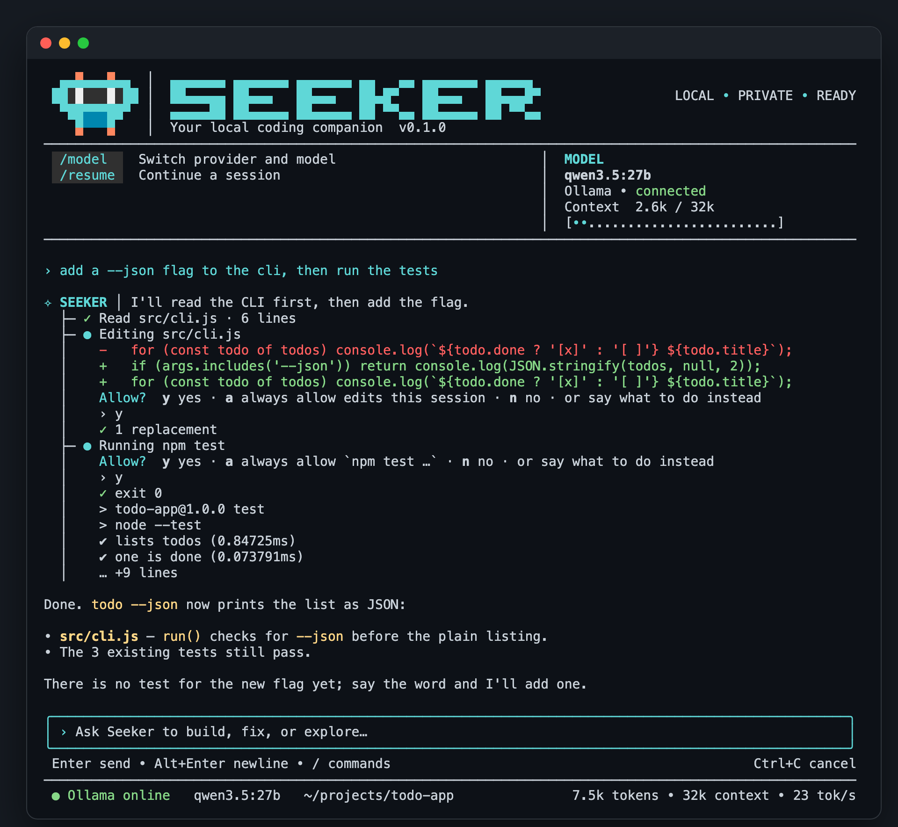

# SEEKER

**English** · [Bahasa Indonesia](README.id.md)

A coding agent for the terminal. Out of the box it runs entirely on your machine on top of
[Ollama](https://ollama.com); `/model` switches it to another local server or to a cloud model.
Plain Node, no build step.



<details>
<summary>The <code>/model</code> picker</summary>


</details>

<sub>Captured from the real interface in a demo project; the model replies in these captures are scripted.</sub>

```
seeker                       # interactive session in this folder
seeker "fix the login bug"   # start with a first message
seeker -c                    # continue the last conversation in this folder
seeker -p "explain the repo" # answer once and exit; can be piped
seeker --yolo                # no permission prompts (dangerous commands are still asked about)
```

Inside a session: `/init`, `/model`, `/key`, `/resume`, `/paste`, `/config`, `/skills`, `/mcp`, `/clear`, `/compact`,
`/status`, `/think`, `/yolo`, `/help`, `/exit`, and `!command`.
Type `/` for command suggestions, Tab to complete, Alt+Enter for a new line, ↑↓ for message history.
The robot in the header blinks and looks around; `/config` → `animation` turns that off.

## Images

Name an image file in your message and the model sees the image, not just its path:

```
› why does the header look wrong in ~/Desktop/shot.png
› /paste what is this error?        # sends the image on the clipboard, e.g. a screenshot
```

Dragging a file into the terminal types its path, which works too. The model can also open an image
itself with `read_file`. PNG, JPEG, GIF and WebP, up to 3.7 MB each.

The model has to support vision; `/status` says whether the current one does. With Ollama that is read
from the model itself. If it cannot see images, SEEKER says so instead of sending a path the model would
have to guess about.

From the phone app, the picture button next to the message box attaches up to four photos or screenshots.
They are made smaller on the phone, then encrypted like everything else it sends. (An existing relay has
to be deployed again once to get the updated app.)

## Install

Needs Node ≥ 22. For local use, also Ollama and a model that supports tool calling.

```
git clone https://github.com/ToingSeeker/seeker-agent.git
cd seeker-agent
npm install
npm link                     # installs the `seeker` command
ollama pull qwen3.5:27b      # or any other tool-calling model
```

`.npmrc` sets `omit=optional` so the Claude Agent SDK's bundled binary (about 320 MB) is not
downloaded; the Claude Code provider uses the `claude` already installed on your machine.

## Models and providers

`/model` picks where the model runs, then one of the models that provider lists at that moment:

| Kind | Providers |
| --- | --- |
| Local | Ollama, LM Studio, llama.cpp server |
| Through Claude Code | **Claude Code** — the Claude Code you are already logged in to works as a full agent with its own tools (Read, Edit, Bash, …), no API key. SEEKER shows what it does and asks before an edit or command runs |
| Cloud | Anthropic (Claude), OpenAI, Google Gemini, xAI Grok, DeepSeek, Mistral, Moonshot Kimi, Groq, Cerebras, Together AI, Fireworks AI, OpenRouter |
| Your own | any OpenAI-compatible endpoint — add `"providers": { "name": { "baseUrl": "https://…/v1" } }` to the config |

API keys are typed in with `/key` (stored in `~/.seeker/config.json`, readable by the owner only) or taken
from the environment (`OPENAI_API_KEY`, `ANTHROPIC_API_KEY`, `GEMINI_API_KEY`, …). From the command line:
`seeker --provider openai -m <model>`.

With a cloud provider, your messages and the contents of files SEEKER reads are sent to that provider;
the header changes from `LOCAL • PRIVATE` to `CLOUD • <NAME>`.

## Permissions

Reading is free. Edits, shell commands and network access ask first; "always" answers are remembered as
rules. A short list of harmless shell commands runs without asking, and commands matching the dangerous
patterns are asked about even with `--yolo`.

## Instructions, memory and skills

- `SEEKER.md` in a project — project instructions; `/init` writes one. Without it: every `AGENTS.md` from the
  repository root down to the working folder, else `CLAUDE.md`, else `.cursorrules` and `.cursor/rules/*.mdc`.
  An instruction file deeper in the tree (`packages/api/AGENTS.md`) is handed to the model the first time it
  works in that folder. A file that reads like a prompt injection is not loaded.
- `~/.seeker/SEEKER.md` — rules that apply in every project.
- `~/.seeker/usage.json` — how many tokens SEEKER has used: counts per day and a running total, nothing else.
  It stays on this machine and is shown on the phone's Home.
- `~/.seeker/memory/` — notes from earlier sessions; `MEMORY.md` is the index (one line per note).
  `~/.seeker/memory/projects/<folder>/` holds notes for one project.
- `skills/` in this repository — skills that ship with SEEKER (engineering, design, data, SEO, marketing,
  business operations), written for SEEKER and licensed with it. A skill of yours with the same name replaces
  one; `/config bundledSkills off` hides them all.
- `~/.seeker/skills/<name>/SKILL.md` and `.seeker/skills/<name>/SKILL.md` — skills, called as `/name`.
  Plugin skills live in `~/.seeker/plugins/<plugin>/skills/…` and are called as `/plugin:name`.
- MCP servers: `mcpServers` in the config or `.seeker/mcp.json`; manage them with `/mcp`. A server defined by a
  project file is a command somebody else wrote: it is listed but not started until you approve it in `/mcp`,
  and again if its entry changes.

Only the memory index goes into the system prompt, capped at 20% of the context window. When the
conversation reaches 80% of the window it is summarised, keeping the most recent part and your request word for word.

## Learning across sessions

SEEKER keeps what it learns, so the next session starts knowing it.

- **Memory it writes itself.** With its `memory` tool SEEKER saves short facts into three small stores:
  who you are (`~/.seeker/memories/USER.md`, 1,375 characters), what holds in every project
  (`MEMORY.md`, 2,200) and what holds in this folder (`projects/<folder>.md`, 2,200). All of them go into
  the system prompt of later sessions. The budget is hard: when a store is full, stale entries are replaced.
  Text that reads like an instruction, or that contains a secret, is refused. `/memory` shows the stores;
  say "remember that …" or "forget …" to change them.
- **Skills it writes itself.** After working out a procedure SEEKER can record it as a skill with
  `skill_manage`, and fix a skill it found to be wrong. `/curator` lists these. One that goes unused for
  14 days is marked stale, after 30 days it is moved to `~/.seeker/skills/.archive`. Skills you installed
  yourself are never touched.
- **A look back after a reply.** Every tenth message, or after a long run of tool steps, a helper with only
  the memory and skill tools reviews the conversation while you read the answer, and saves what is worth
  keeping. It is dropped the moment you type again. Switch it off with `/config review off`.
- **You decide what is kept.** What is saved is read back as context in every later session, so saving
  asks first, showing the text; answer "always" to stop being asked for that session, or set
  `/config autoLearn on` to never be asked. The look back after a reply saves only what you have allowed
  this way. Skills are written only inside `~/.seeker/skills`, never through a link or into a project.
- **Past conversations.** `session_search` lets SEEKER search and read earlier sessions from every folder,
  so "what did we decide about the webhook last week?" does not need you to repeat it.

## Attaching context with @

Put any of these in a message and its content is attached, so the model starts with it:

| Reference | Attaches |
| --- | --- |
| `@file:src/app.js` | the file |
| `@file:src/app.js:10-40` | lines 10 to 40 |
| `@folder:src` | a listing of the folder |
| `@diff` · `@staged` | unstaged / staged git changes |
| `@git:3` | the last 3 commits, with their changes |
| `@url:https://…` | the page as text |

Paths stay inside the working folder and credential files are never attached. Attachments over a quarter
of the context are flagged; over half, they are refused.

## Undoing changes

Before the first change of a message — a file written or edited, or a shell command that can destroy files —
SEEKER snapshots the folder. `/rollback` lists the snapshots, `/rollback 2` restores the second-newest,
`/rollback 2 src/app.js` one file from it, and `/rollback diff 2` shows what changed since. A rollback is
itself snapshotted first, so it can be undone.

Snapshots live in a separate git repository under `~/.seeker/checkpoints`; nothing is written into the
project's own `.git`. `node_modules`, build output, `.env` files and files over 10 MB are left out, and so
are not restored. Switch it off with `--no-checkpoints` or `/config checkpoints off`.

## Working on its own

- **`/goal <what to achieve>`** — SEEKER keeps going, message after message, until a judge (the same model, asked
  separately) finds the goal done. It stops after 20 turns, when it is blocked and needs you, or when you press
  Ctrl+C. `/goal pause`, `/goal resume`, `/goal clear`.
- **`/loop 5m <prompt>`** re-runs a prompt every five minutes; **`/loop <prompt>`** lets SEEKER pace itself (it
  looks less often while nothing changes). `--times N` and `--until <condition>` end it; so does the model saying
  the task is finished. `/loop stop`.
- **`/heartbeat every 10m <instruction>`** re-enters the session with that instruction whenever it is idle.
- **Scheduled jobs.** Ask in plain words ("every weekday at 9, summarise the open pull requests") and SEEKER
  creates a job with its `cronjob_manage` tool, after asking you. A job runs in a fresh session of its own: it may
  read and run harmless commands, changes files only if you allowed that for the job, and never runs a risky
  command. Replies are kept in `~/.seeker/cron/output` and shown in the open session (or pushed to your phone by
  `seeker remote`). Jobs run while SEEKER is open; to run them with nothing open, have the system scheduler call
  `seeker cron tick` every minute. `/cron` lists, pauses and removes them.
- **Several helpers at once.** The `task` tool can run up to three helper agents side by side, each on its own
  piece of work; approval questions are put one at a time.

These three (`/goal`, `/loop`, `/heartbeat`) live with the session: they end when you quit.

## As a backend for other apps

`seeker serve` offers SEEKER as an OpenAI-compatible API (`/v1/chat/completions`, streaming or not, and
`/v1/models`), so a chat frontend such as Open WebUI or a script using the `openai` package can use it, with
SEEKER's tools doing the work in the folder it was started in:

```
SEEKER_API_KEY=$(openssl rand -hex 24) seeker serve          # http://127.0.0.1:8642/v1
```

It listens on this machine only and every request needs the key. Nobody is there to approve anything, so a
request can read files and run harmless commands but not change anything; `"apiServer": { "allowChanges": true }`
in the config lets requests edit files and run ordinary commands. Risky commands are refused either way.

## In a chat app

`seeker gateway` answers in Telegram, Discord or Slack. Each chat is its own conversation, working in the folder
the gateway was started in. Nothing has to be reachable from the internet: SEEKER connects out to the chat service.

```json
"gateway": {
  "telegram": { "token": "123456:ABC…", "allow": ["123456789"] },
  "discord":  { "token": "…", "allow": ["223344556677889900"] },
  "slack":    { "botToken": "xoxb-…", "appToken": "xapp-…", "allow": ["U012ABCDEF"] }
}
```

Set up only the ones you use; the tokens can also come from `TELEGRAM_BOT_TOKEN`, `DISCORD_BOT_TOKEN`,
`SLACK_BOT_TOKEN` and `SLACK_APP_TOKEN`.

- **Telegram:** make a bot with @BotFather and use its token.
- **Discord:** make an application with a bot, invite it to your server, and use the bot token. No privileged intent
  is needed.
- **Slack:** make an app with Socket Mode on, an app-level token (`connections:write`), the bot scopes `chat:write`,
  `im:history` and `app_mentions:read`, and the events `message.im` and `app_mention`.

Nobody is let in by default. Only the user ids in `allow` get an answer; anyone else is told their own id once, so
to find yours, message the bot and copy the id it replies with. In a group or channel the bot answers only when it is
mentioned. Before SEEKER edits a file or runs a command it asks in the chat (`y`, `n`, or say what to do instead),
and "run without asking" is never available from a chat. `/new` starts a fresh conversation, `/stop` interrupts,
`/status` shows the model and folder.

## In an editor

`seeker acp` runs SEEKER as an agent inside an editor that speaks the
[Agent Client Protocol](https://agentclientprotocol.com), such as Zed. The editor starts the process itself and
shows the answer, the tool steps and the permission questions in its own panel. In Zed's settings:

```json
"agent_servers": { "SEEKER": { "type": "custom", "command": "seeker", "args": ["acp"] } }
```

It uses the provider, model and permission setting from `~/.seeker/config.json`. Sessions are not reloaded by the
editor yet, and MCP servers passed by the editor are ignored (SEEKER's own `/mcp` servers are not started either).

## Hooks

Commands of your own that run at fixed points and can veto or adjust what happens. In `~/.seeker/config.json`:

```json
{ "hooks": { "pre_tool_call": [{ "matcher": "bash|write_file", "command": "~/bin/guard.sh", "timeout": 60 }] } }
```

Events: `pre_tool_call`, `post_tool_call`, `pre_llm_call`, `post_llm_call`, `on_session_start`, `on_session_end`.
A hook gets one line of JSON on stdin (`hook_event_name`, `tool_name`, `tool_input`, `cwd`, …). A `pre_tool_call`
hook may print `{"action":"block","message":"…"}` (or exit with code 2) to stop the call, or
`{"action":"modify","args":{…}}` to change its arguments; a `pre_llm_call` hook may block the message or print
`{"context":"…"}` to add to it. A hook that fails does not stop the work unless it has `"fail_closed": true`.
No hook runs until you have approved that exact command in `/hooks`.

## Reading and checking files

`read_file` also reads PDFs (needs `pdftotext`), Word and OpenDocument files, `.xlsx`, notebooks and SQLite
databases as text. After `write_file` or `edit_file`, JavaScript, JSON, Python, shell, Ruby and PHP files are
checked for syntax, and a file that does not parse is reported with the result.

## Backup models and several API keys

In `~/.seeker/config.json`:

```json
{
  "fallback": [
    { "provider": "openrouter", "model": "anthropic/claude-sonnet-5.5" },
    { "provider": "ollama", "model": "qwen3.5:27b" }
  ],
  "providers": { "openai": { "apiKeys": ["sk-…", "sk-…"], "keyStrategy": "fill_first" } }
}
```

When the chosen model is rate limited, out of credit, rejects the key or is down, SEEKER first moves to the
provider's next API key, then waits and retries, then moves down the `fallback` list, and says so. Your own
model is tried again on a later message. A request that is simply wrong (too long, malformed) is not sent
elsewhere. `keyStrategy` is `fill_first` (default), `round_robin`, `least_used` or `random`; `/status` shows
the chain.

## Remote control from a phone

`seeker remote` runs the agent on your computer and connects it to a relay (`remote-server/`, a
dependency-free Node server you deploy yourself, for example on Railway). The phone opens the web app
served by that relay.

Every user runs their own relay. A relay knows one access token and serves one computer; there is no
shared or public relay, and no account to sign up for. It is a single Node file with no dependencies and
no database, so the smallest plan of any host is enough.

### Set it up

**1. Create your secret.** On the computer where SEEKER is installed:

```
seeker remote --setup
```

It prints one line to copy:

```
SEEKER_REMOTE_AUTH=<64 hex characters>
```

This is a hash of your access token. It lets the relay recognise your devices and is safe to hand to a
host; it cannot be used to read or send anything. The secret itself stays in `~/.seeker/config.json`.

**2. Deploy the relay.** Deploy the folder `remote-server/` (not the whole repository) with that variable set.

On [Railway](https://railway.com), with its CLI installed and `railway login` done:

```
cd remote-server
railway init                                   # create a new project
railway up                                     # first deploy; creates the service
railway variable set "SEEKER_REMOTE_AUTH=<the value from step 1>"  # redeploys with it
railway domain                                 # gives the service a public https address
```

On any other host (Render, Fly.io, a VPS, …) the relay needs:

| | |
| --- | --- |
| Start command | `node server.mjs`, in `remote-server/` |
| Node | 20 or newer |
| `SEEKER_REMOTE_AUTH` | the value from step 1 |
| `PORT` | the port to listen on; most hosts set it for you (default 8787) |
| Address | public and **https** — the phone app and its notifications do not work over plain http |
| Health check | `GET /healthz` answers `{"ok":true}` |
| Proxy | must not buffer responses (the relay streams events) or cut idle connections short |
| `SEEKER_TRUST_PROXY=1` | only behind a proxy that sets `x-forwarded-for` itself; Railway is detected automatically |

Check it: `https://<your-relay>/healthz` shows `{"ok":true}`, and `https://<your-relay>/` shows the SEEKER sign-in page.

**3. Tell SEEKER where the relay is.**

```
seeker remote --url https://<your-relay>
```

**4. Pair your phone.**

```
seeker remote --setup
```

This time it prints a link that ends in `#k=…`. Open it on your phone (on macOS it is also copied to the
clipboard). The link holds your secret: anyone who has it can see your sessions and approve commands on
your computer, so do not post it, screenshot it, or send it over a channel you do not trust.

On iPhone, use Share → **Add to Home Screen** and open SEEKER from there; on Android, the browser menu →
**Install app** (or Add to Home screen).
Then turn on notifications in the app's Settings tab.

**5. Start it.**

```
seeker remote                          # the current folder
seeker remote ~/project-a ~/project-b  # several projects, one workspace each
```

Leave it running; the phone shows the computer as online. The computer has to stay on, and on macOS it is
kept awake while `seeker remote` runs. Stop it with Ctrl+C.

### What the phone shows

- **Home → Control Center** — what the agent is doing now (or, when nothing runs, how the latest task ended),
  the connected computer with its state and the measured round trip, the last 24 hours (projects that were
  active and tool runs, counted from the conversations themselves), the tokens used today — tap it for the
  last seven days and the total since counting began — and
  `/init` `/model` `/resume`.
- **Home → Projects** — the open projects in one list, with search (name, folder, branch), sorting and a
  filter for terminal sessions. Under **On your Mac**, the project folders found in your home folder open
  with one tap. The **+** opens a folder by its path, or makes a new one for a new project. A new folder can
  only be made inside your home folder, and never in a hidden one.
- **Sessions** — every open project as one compact row: its name, the latest instruction, a small status pill
  (Executing, Approval needed, Queued, Failed, Stopped, Completed, Idle), the model, tool runs and when it was
  last active. Search by project, instruction or model; filter by status (the counts are live); sort by
  activity, name or status. The session you opened last is marked in amber.
- **A session** — what the agent is doing right now (thinking, running a tool, writing, waiting for you,
  finished, failed or stopped), every step as it happens with its output, and context, tokens and tool
  counts as the computer reports them. Stop, Review, Resume and Retry appear only when they apply.
- **Sending while it works** — a message sent while the agent is busy asks where it should go. *Queue next*
  keeps it on the computer (`~/.seeker/queue.json`) and runs it when the current task has completed, in the
  order sent. *Steer current task* hands it to the running task, which reads it before its next step; that
  works with Ollama and the API providers, not with Claude Code, which runs a whole task in one request and
  is offered Queue only. After a task that was stopped or failed, and after `seeker remote` is restarted,
  nothing waiting starts by itself: the queue is paused until you resume it. Pictures cannot be queued, and
  a session typed in a terminal has no queue.
- **Approvals** — each command and each file change waits here. A change is shown as a diff with line
  numbers; a command the safety patterns flag is marked dangerous. One request is one command or one file.
- **Settings** — connection, model, and which notifications this phone gets: finished tasks, approvals
  and questions, errors. Everything `/config` holds is here too: thinking, whether to ask for approval,
  context window, steps per message, how long a model stays in memory, the Ollama address, and the two
  terminal display settings. A cloud provider's API key can be entered here; it is stored on the computer
  and never sent back. A setting takes effect at once for projects opened from the phone; a `seeker`
  already running in a terminal keeps what it started with.

Nothing on these screens is estimated on the phone. A number the computer has not reported shows as “—”.

### A session you are typing in the terminal

While `seeker remote` is running, a plain `seeker` started in a terminal on the same computer joins it by
itself and shows on the phone as a *terminal session*. Nothing has to be set up; if `seeker remote` is not
running, the terminal works exactly as before.

- **A picture from the phone** — send a screenshot with no text and its path is put into the message you are
  typing in the terminal, as if you had dragged the file in. Finish the sentence and press Enter.
- **A message from the phone** — one with words runs as a turn of its own when the terminal is free. What
  you had half typed is back in the box afterwards. `!` shell lines are not run from the phone.
- **Commands and skills from the phone** — `/status`, `/compact`, `/skills`, `/memory`, `/cron`, `/goal`,
  `/loop`, `/help` and any `/<skill>` run as they would typed in the terminal (in a project opened from the
  phone too). Settings (`/yolo`, `/think`, `/config`) change only projects opened from the phone, and are saved
  like the Settings tab; a terminal session's own settings are changed in that terminal. What needs a picker or
  must not come from a lost phone stays in the terminal: `/hooks`, `/mcp`, `/rollback`, `/resume`, `/key`,
  `/paste`, `/exit`.
- **Approvals** — asked in both places; the first answer decides and the other one closes.
- **Not from the phone** — a new conversation, another model, and closing the session are done in the
  terminal. A session started with `--yolo` shows on the phone but takes no tasks from it.

### Later

- **New phone:** run `seeker remote --setup` again and open the link on it.
- **Lost phone, or the link leaked:** delete `"secret"` under `"remote"` in `~/.seeker/config.json`, run
  `seeker remote --setup`, put the new `SEEKER_REMOTE_AUTH` on the relay, and pair your phones again. The old
  link stops working as soon as the relay has the new value.
- **Updating the relay:** pull the repository and deploy `remote-server/` again (`railway up`). Nothing is
  stored on it, so nothing is lost.
- **Trying it locally first:** `SEEKER_REMOTE_AUTH=<value> node remote-server/server.mjs`, then
  `seeker remote --url http://localhost:8787`. Plain http is accepted for `localhost` only.

### How it is protected

- The computer only makes outbound connections; no port is opened.
- Conversation and commands are encrypted between phone and computer (AES-256-GCM). The relay holds only
  a hash of the access token (`SEEKER_REMOTE_AUTH`) and can neither read nor forge anything.
- Edits and commands need approval on the phone unless you switch that off (in `/config`, or in the phone's
  Settings). Even then, risky commands and files outside the project folder are still asked about.
- The relay stores nothing on disk; after a restart the computer sends its state again.
- Wrong tokens are locked out per address. On Railway the caller's address is read from `x-forwarded-for`;
  behind another proxy that sets that header itself, set `SEEKER_TRUST_PROXY=1`. Without a proxy leave it unset.
- Push notifications (approval needed, question from the model, task finished) go straight from the
  computer to the phone's push service with Web Push encryption (`src/webpush.mjs`); the relay is not
  involved. Turn them on in the app's Settings. On iPhone the app must first be added with
  Share → Add to Home Screen.

Developed on macOS. The pairing-link copy and the keep-awake helper are macOS-only; everything else is
plain Node.

## How it works

| File | What it does |
| --- | --- |
| `src/cli.mjs` | arguments, startup, interactive loop |
| `src/agent.mjs` | the agent loop: model → tool → result → model, plus context compaction |
| `src/tools.mjs` | `read_file` `write_file` `edit_file` `bash` (also in the background) `process_output` `process_stop` `glob` `grep` `list_dir` `web_fetch` `web_search` `ask_user` `task` `skill` `memory` `session_search` `skill_manage` `cronjob_manage` `todo_write` |
| `src/permissions.mjs` | what runs freely and what asks first |
| `src/prompt.mjs` | system prompt, project instructions, memory and skill sections |
| `src/providers.mjs` | provider list and adapters: Ollama, OpenAI-compatible, Anthropic (SDK) |
| `src/claude-code.mjs`, `src/external-tools.mjs` | the Claude Code provider through the Claude Agent SDK; display and permission class of its tools |
| `src/ollama.mjs`, `src/http.mjs` | Ollama streaming client and basic HTTP |
| `src/mcp.mjs` | MCP servers: extra tools named `mcp__<server>__<tool>` |
| `src/skills.mjs` | skill discovery and loading |
| `src/memory.mjs`, `src/review.mjs` | the stores SEEKER writes itself, the scan that keeps instructions and secrets out, the look back after a reply |
| `src/skill-manage.mjs` | skills SEEKER writes and patches, how often each is used, the curator |
| `src/session-search.mjs` | searching and reading earlier conversations |
| `src/context-files.mjs`, `src/references.mjs` | project instruction files and `@` references |
| `src/checkpoints.mjs` | snapshots before a change, `/rollback` |
| `src/failover.mjs` | API key rotation, retries and backup providers |
| `src/autonomy.mjs` | `/goal`, `/loop` and `/heartbeat` |
| `src/cron.mjs`, `src/cron-runner.mjs` | scheduled jobs: schedules, the job store, running a due job |
| `src/hooks.mjs` | the user's shell hooks and their approval |
| `src/gateway.mjs`, `src/platforms/` | `seeker gateway`: Telegram, Discord and Slack |
| `src/acp.mjs` | `seeker acp`: the Agent Client Protocol for editors |
| `src/api-server.mjs` | `seeker serve`: the OpenAI-compatible API |
| `src/lint.mjs`, `src/extract.mjs` | syntax check after a write; documents read as text |
| `src/remote.mjs`, `src/webpush.mjs`, `remote-server/` | remote control: daemon on the computer, push notifications, relay and phone web app |
| `src/session.mjs`, `src/config.mjs` | saved conversations (`~/.seeker/sessions/`) and settings (`~/.seeker/config.json`) |
| `src/commands.mjs`, `src/menu.mjs` | slash commands, the `/config` menu, the `/model` and `/resume` pickers |
| `src/ui.mjs`, `src/markdown.mjs`, `src/text.mjs` | rendering: header, panels, tool-step tree, status bar; measuring and wrapping coloured text |
| `src/theme.mjs` | the one palette for the terminal and the phone app (amber brand, blue tool at work, purple thinking, green done, red failed); written as 24-bit, 256 or 16 colours depending on the terminal, none with `NO_COLOR` |
| `src/images.mjs` | images in a conversation: finding the files a message names, loading them, the clipboard |
| `src/mascot.mjs` | the robot and the wordmark in the header, drawn as pixels, and the robot's animation |
| `src/screen.mjs`, `src/input.mjs` | full-screen layout (header pinned on top, input box at the bottom) and the input editor |

## Tests

```
npm test
```

The tests run offline and in a scratch home folder of their own. When trying things by hand, use
`SEEKER_HOME=/tmp/some-folder seeker` so your real configuration and history are left alone.

## Contributing

See [CONTRIBUTING.md](CONTRIBUTING.md). Security problems are reported privately, see [SECURITY.md](SECURITY.md).

## License

[Apache License 2.0](LICENSE)
